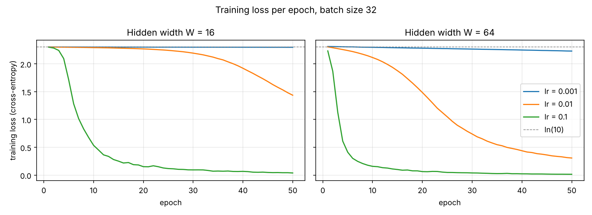

# Lab 2 – A Neural Network from Scratch

## 1. Goal

Build a two-hidden-layer neural network in plain NumPy, with no deep learning framework. The lab covers the forward pass, the cross-entropy loss and the backward pass. The hand-derived gradients are verified with numerical gradient checking. The effect of the learning rate and the hidden width on training is then studied, and the cost of the forward and backward passes is measured.

## 2. Method

**Data.** `load_digits`: 1797 images of 8×8 pixels (64 features), 10 classes. Pixel values are divided by 16 to lie in [0, 1], and the labels are one-hot encoded. 70/30 stratified split with `random_state=42` (1257 train / 540 test). All seeds are fixed to 42.

**Network design.**

```
input 64 → Linear(64, W) → ReLU → Linear(W, W) → ReLU → Linear(W, 10) → softmax
```

| Parameter | Shape | W = 16 | W = 64 |
|---|---|---|---|
| W1, b1 | (64, W), (W,) | 1,024 + 16 | 4,096 + 64 |
| W2, b2 | (W, W), (W,) | 256 + 16 | 4,096 + 64 |
| W3, b3 | (W, 10), (10,) | 160 + 10 | 640 + 10 |
| **Total** | | **1,482** | **8,970** |

Weights are drawn from N(0, 0.01), read as mean 0 and **variance** 0.01 (standard deviation 0.1). Biases start at 0.

**Forward pass and loss** (`src/mlp.py`). Each layer computes `z = aW + b`. The hidden layers use ReLU. The output uses a softmax with the row maximum subtracted first, for numerical stability. The loss is the mean cross-entropy, L = −(1/B) Σ y·log p.

**Backward pass.** The gradients are derived with the chain rule. Softmax and cross-entropy combine into a single simple term:

- dz3 = (p − y) / B
- dW3 = a2ᵀ dz3, db3 = Σ dz3
- dz2 = (dz3 W3ᵀ) ⊙ 1[z2 > 0]
- dW2 = a1ᵀ dz2, db2 = Σ dz2
- dz1 = (dz2 W2ᵀ) ⊙ 1[z1 > 0]
- dW1 = xᵀ dz1, db1 = Σ dz1

**Checks** (`src/sanity_checks.py`).
- The output shape and row sums are checked on a batch of 32.
- The untrained loss is computed on the full training set.
- Gradient check: 10 random weights (from W1, W2, W3) per width are nudged by ±1e-5. The central difference (L₊ − L₋)/2ε is compared with the analytic gradient using the relative error |a − n| / max(|a|, |n|).
- The gradient check uses the first 128 training samples (reason in Results).

**Training** (`src/train.py`). Plain mini-batch SGD with batch size 32 and 50 epochs. The data is reshuffled every epoch. All 6 combinations of learning rate {0.001, 0.01, 0.1} and width {16, 64} are trained. Every run starts from the same initial weights and the same shuffling order. Train loss, test loss and test accuracy are logged after every epoch.

**Timing** (`src/timing.py`). The forward and backward passes are timed separately: 1 warm-up, then the median of 100 runs, on a batch of 32 and on the full training set (1257). The matmul FLOPs of each pass (2·m·k·n per product) are counted alongside.

All steps can be reproduced with `python lab02/src/run_all.py`.

## 3. Results

### Sanity checks (`results/sanity_checks.txt`)

| Check | W = 16 | W = 64 |
|---|---|---|
| Output shape (batch 32) | (32, 10) ✔ | (32, 10) ✔ |
| max \|row sum − 1\| | 2.2e-16 ✔ | 2.2e-16 ✔ |
| Untrained loss (ln 10 = 2.3026) | 2.3032 ✔ | 2.3128 ✔ |
| Gradient check, rel. error < 1e-6 | **10 / 10** ✔ | **10 / 10** ✔ |

The largest relative error among the 20 checked weights is 3.6e-7. Three of them have a gradient of exactly 0, both analytic and numerical. Their weights connect either to a pixel that is always 0 in these samples or to a ReLU unit that is inactive for every sample. Full table: `results/grad_check.csv`.

When the check was first run on all 1257 training samples, only 7/10 (W = 16) and 9/10 (W = 64) weights passed. There were two causes:

- **ReLU kinks.** In two of the failures, the ±1e-5 nudge pushed a ReLU input across 0 for at least one sample. The loss is not differentiable at that point, so the finite difference measures a mix of two slopes. The column `kink_crossed` in the CSV detects exactly this case.
- **Round-off.** The other two failures had gradients of only 1e-6 to 1e-7. The loss difference L₊ − L₋ is then close to float64 round-off.

On a 128-sample batch, kink crossings are much less likely and every check passes.

### Loss curves (`results/loss_curves.png`)



### Final results after 50 epochs (`results/final_accuracy.csv`)

| Width | lr | Final train loss | Final test loss | Test accuracy |
|---|---|---|---|---|
| 16 | 0.001 | 2.2977 | 2.2983 | 0.1778 |
| 16 | 0.01 | 1.4363 | 1.4207 | 0.6556 |
| 16 | 0.1 | 0.0383 | 0.1372 | 0.9648 |
| 64 | 0.001 | 2.2299 | 2.2314 | 0.3574 |
| 64 | 0.01 | 0.3073 | 0.3356 | 0.9130 |
| 64 | 0.1 | 0.0151 | 0.1171 | **0.9685** |

### Timing breakdown (`results/timing.csv`, median of 100 runs, µs)

| Width | Batch | Forward | Backward | Backward / Forward | Matmul FLOP ratio |
|---|---|---|---|---|---|
| 16 | 32 | 30.80 | 34.60 | 1.12 | 1.29 |
| 16 | 1257 | 701.55 | 620.15 | 0.88 | 1.29 |
| 64 | 32 | 47.55 | 61.20 | 1.29 | 1.54 |
| 64 | 1257 | 1285.45 | 1673.90 | 1.30 | 1.54 |

**Which pass dominates.** In three of the four settings the backward pass is slower. The reason is the number of matrix multiplications:

- The forward pass needs 3: x·W1, a1·W2, a2·W3.
- The backward pass needs 5: one weight gradient per layer (aᵀ·dz) plus two products that carry the gradient back to the previous layer (dz·Wᵀ).
- The input gradient dx is not needed, which is why the backward pass costs less than 2× the forward pass.

Counting FLOPs gives a backward/forward ratio of 1.29 for W = 16 and 1.54 for W = 64. For W = 64 the W×W products, which appear once forward and twice backward, make up a larger share of the work. With W = 64 the measured ratio (1.29–1.30) follows the FLOP ratio, so matrix multiplication dominates the runtime.

The exception is W = 16 with the full batch, where the forward pass is slower (0.88). Here the matrices are thin (1257×64 by 64×16) and the matmuls are cheap. The element-wise work then takes a large share of the time, and most of it sits in the forward pass:

- the softmax: one `exp` per output, plus a max and a sum per row;
- creating the ReLU outputs;
- adding the biases.

The backward pass only needs comparisons and multiplications by the ReLU masks. So matrix multiplication dominates only once the layers are wide enough; for very small layers the memory-bound element-wise operations can outweigh it.

## 4. Conclusions

1. **Gradient checking is a reliable test, but only away from non-differentiable points.** The hand-derived backward pass matches the numerical slope to better than 1e-6 on every checked weight. The failures on the full data set taught me that a failing check does not always mean a wrong gradient: a ReLU kink or a tiny gradient can break the finite difference itself. Logging whether a kink was crossed made this visible instead of guessing.
2. **The learning rate matters more than the width here.** With lr = 0.001 neither network leaves the ln(10) plateau within 50 epochs (test accuracy 18–36 %). lr = 0.01 learns slowly, and lr = 0.1 reaches about 96–97 % for both widths. The wider network learns faster at every learning rate because it has more paths for the gradient. At lr = 0.1, however, the final accuracy of the two widths is almost the same (96.5 % vs. 96.9 %), so the six times more parameters buy little on this small dataset.
3. **The backward pass usually dominates because it does more matrix multiplication, but only once the layers are wide enough.** The backward pass does 5 matrix products against 3 in the forward pass. With W = 64 it is consistently about 1.3× slower, and one training step costs about 2.3× a forward pass, which is why inference is much cheaper than training. With W = 16 and a large batch the forward pass was actually slower, because the softmax and other element-wise operations cost more than the tiny matrix products. FLOP counts predict runtime well only when the matrix products are the main work.
