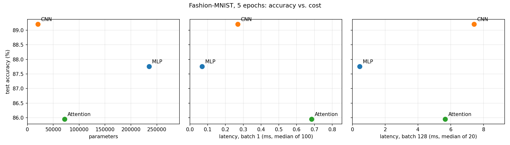

# Lab 3 – Architectures and Their Costs

## 1. Goal

Compare three architecture families on the same task: a multi-layer perceptron, a convolutional network and a small attention (transformer) model. The task is Fashion-MNIST classification. The models are compared on parameters, FLOPs, inference latency and test accuracy. Hand-calculated FLOPs are checked against a profiling tool (thop). The goal is to explain, with the memory access patterns of each layer type, which architecture gives the best accuracy for its cost.

## 2. Method

**Data.** `torchvision.datasets.FashionMNIST` with `ToTensor()` and `Normalize((0.2860,), (0.3530,))`. The official 60k training set is split into 55k train and 5k validation (`random_split` with seed 42). The official 10k test set is used for the final accuracy. Batch size is 128.

**Models** (`src/models.py`), exactly as specified:

| Model | Layers |
|---|---|
| MLP | Flatten 784 → Linear 256 → ReLU → Linear 128 → ReLU → Linear 10 |
| CNN | Conv(1→16, 3×3, pad 1) → ReLU → MaxPool 2 → Conv(16→32, 3×3, pad 1) → ReLU → MaxPool 2 → Flatten → Linear(1568 → 10) |
| Attention | 16 patches of 7×7 → Linear(49 → 64) + learned position embedding → 2 × TransformerEncoderLayer(d_model 64, 4 heads, FF 128) → mean pool → Linear(64 → 10) |

The learned position embedding (16 × 64 = 1,024 parameters) is the only addition to the specification. Without it, the encoder has no information about where a patch is in the image.

The specified layers do not land in the 100k–150k target range: the MLP has 235k parameters and the CNN only 20k. I kept the given layer sizes so the comparison stays the one the manual defines, and treat the different sizes as part of the trade-off.

**Cost** (`src/cost.py`).
- *Parameters:* `torchinfo.summary`, checked against `sum(p.numel())`.
- *FLOPs:* hand formulas from Ch. 4, counting multiply-adds of linear, conv and attention products as 2 FLOPs each. Bias, activations, pooling, softmax and LayerNorm are not counted.
- *thop:* thop reports MACs, so its numbers are multiplied by 2 before comparing.
- *Latency:* CPU (8 threads), `eval()` + `inference_mode`. Batch 1: median of 100 runs after 10 warm-ups. Batch 128: median of 20 runs after 3 warm-ups.

**Training** (`src/train.py`). Adam, lr 1e-3, batch 128, 5 epochs, cross-entropy. Validation accuracy is logged after every epoch; test accuracy is measured once at the end.

All steps can be reproduced with `python lab03/src/run_all.py`.

## 3. Results

### Hand calculations

Photos of the hand calculations: [page 1 – parameters, Linear and Conv2d FLOPs](results/paper_1_params_flops.jpg), [page 2 – attention parameters and encoder-layer FLOPs](results/paper_2_attention.jpg).

**Parameters**

| Model | Calculation | By hand | torchinfo |
|---|---|---|---|
| MLP | (784·256+256) + (256·128+128) + (128·10+10) | 235,146 | 235,146 |
| CNN | (1·16·9+16) + (16·32·9+32) + (1568·10+10) | 20,490 | 20,490 |
| Attention | 3,200 (proj) + 1,024 (pos) + 2 × 33,472 (encoder) + 650 (head) | 71,818 | 71,818 |

One encoder layer has 33,472 parameters: QKV 12,480 + output projection 4,160 + FFN 8,320 + 8,256 + two LayerNorms 256.

**FLOPs for one layer of each type** (`results/flops_layer.csv`, per image)

| Layer | Formula | By hand | thop × 2 | thop / hand |
|---|---|---|---|---|
| Linear(784, 256) | 2 · 784 · 256 | 401,408 | 401,408 | 1.00 |
| Conv2d(16→32, 3×3), 14×14 out | 2 · 3 · 3 · 16 · 32 · 14 · 14 | 1,806,336 | 1,806,336 | 1.00 |
| Encoder layer (seq 16, d 64, FF 128) | see below | 1,114,112 | 540,672 | 0.49 |

The encoder layer breaks down as follows:

| Part | Formula | FLOPs | Counted by thop? |
|---|---|---|---|
| QKV projections | 2 · 16 · 64 · 3 · 64 | 393,216 | no |
| Attention scores QKᵀ | 2 · 16² · 64 | 32,768 | no |
| Weighted sum A·V | 2 · 16² · 64 | 32,768 | no |
| Output projection | 2 · 16 · 64 · 64 | 131,072 | no |
| Feed-forward (2 linears) | 2 · 2 · 16 · 64 · 128 | 524,288 | yes |
| **Total** | | **1,114,112** | |

**Whole model** (`results/flops_model.csv`)

| Model | Hand FLOPs | thop × 2 | thop × 2, default call |
|---|---|---|---|
| MLP | 469,504 | 469,504 | 469,504 |
| CNN | 2,063,488 | 2,063,488 | 2,063,488 |
| Attention | 2,329,856 | 1,182,976 | 101,632 |

**Explaining the gap.** For linear and convolutional layers, thop and the hand formula agree exactly. thop counts the same multiply-adds and also ignores the bias. For the attention model there are two separate problems:

1. **Self-attention is not counted at all.** thop has no counting rule for `nn.MultiheadAttention`. Its output projection is also never called as a module: PyTorch reads its weights directly inside `F.multi_head_attention_forward`. As a result the QKV projections, both attention matmuls and the output projection are missing, 589,824 FLOPs per layer. thop's 540,672 for one layer is the feed-forward part (524,288) plus 16,384 that it counts for the two LayerNorms, which my hand count leaves out.
2. **A default thop call hides the whole encoder.** `thop.profile` switches the model to eval mode and runs it without gradients. In that state `nn.TransformerEncoderLayer` uses a single fused kernel (PyTorch's inference "fast path"), so no inner layer is visible to thop's hooks. The default call reports only the patch projection and the head: 101,632 FLOPs, 4 % of the real cost. Keeping the profiled copy in training mode disables the fast path and gives the 1,182,976 above.

For architectures that are not plain linear or conv stacks, profiling-tool FLOPs should therefore be checked by hand. For this model the tool undercounts the work by about 2×, or by 23× with a default call.

### Latency (`results/latency.csv`, CPU, 8 threads)

| Model | Batch 1 (ms, median of 100) | Batch 128 (ms, median of 20) | Per image at batch 128 (µs) | Achieved GFLOP/s at batch 128 |
|---|---|---|---|---|
| MLP | 0.069 | 0.450 | 3.5 | 134 |
| CNN | 0.269 | 7.424 | 58.0 | 36 |
| Attention | 0.684 | 5.662 | 44.2 | 53 |

Achieved GFLOP/s = hand FLOPs × batch / latency.

### Accuracy after 5 epochs (`results/test_accuracy.csv`)

| Model | Validation accuracy | Test accuracy | Training time, 5 epochs (s) |
|---|---|---|---|
| MLP | 0.8826 | 0.8776 | 86 |
| CNN | 0.8974 | **0.8921** | 113 |
| Attention | 0.8664 | 0.8595 | 141 |

### Trade-off plots (`results/tradeoff_plots.png`)

### Which architecture is most cost-effective

The answer depends on which resource is scarce. The access pattern of each layer type explains the numbers (Ch. 4.6–4.7).

- **CNN: best accuracy per parameter.** It reaches the highest accuracy (89.2 %) with the fewest parameters (20k, 11× fewer than the MLP). A convolution reuses the same 3×3 kernels at every position of the image, so a few weights produce a lot of computation. The cost moves from weights to activations: each image creates 16×28×28 and 32×14×14 feature maps that have to be written, read by the pooling and read again. On a CPU the convolution also unfolds its input into a larger matrix first (im2col). This data movement explains why the CNN uses its FLOPs least efficiently (36 GFLOP/s) and is the slowest model at batch 128.
- **MLP: best accuracy per millisecond.** It does the fewest FLOPs (0.47 M) and they are all dense matrix multiplications. At batch 128 every weight read from memory is reused for 128 images, which is the best case for a CPU's matrix routines (134 GFLOP/s). It is 4–16× faster than the other two models and only 1.45 points less accurate than the CNN. The price is the largest model (235k parameters, about 0.9 MB in float32). Every weight must be read for every input, so at batch 1 the model is limited by memory bandwidth rather than compute.
- **Attention: dominated at this scale.** It has the lowest accuracy, it is slower than the MLP, and it has more parameters than the CNN. Its work is split into many small operations: projections on 16×64 matrices, a softmax, two LayerNorms, reshapes for the 4 heads. The attention weights are computed at run time, so the data access depends on the input. With so little work per operation, the fixed overhead per operation dominates, which shows most at batch 1 (0.68 ms, about 10× the MLP). The quadratic part (QKᵀ and A·V) is only 6 % of the FLOPs with 16 patches, so its cost here comes from the many small, data-dependent operations rather than from sequence length.

For a memory-limited target (for example a microcontroller), the CNN is the most cost-effective choice. For a latency- or throughput-limited server, the MLP is. The attention model would need more data, more epochs and longer sequences to pay off.

## 4. Conclusions

1. **Parameter count, FLOPs and latency measure different things.** The CNN has the fewest parameters but is the slowest model at batch 128; the MLP has 11× more parameters and is the fastest. Weight reuse makes a model small, but it does not make it fast if the reuse comes with large activation maps that must be moved through memory.
2. **Profiling tools are only as good as their counting rules.** thop matched my hand calculation exactly for linear and conv layers, but it missed all of self-attention. A default call hid the entire transformer encoder because of PyTorch's fused fast path. Without the hand calculation I would have believed the attention model was the cheapest of the three, when it is actually the most expensive in FLOPs.
3. **The inductive bias matters more than size on small images.** With the same optimizer and only 5 epochs, the convolution's built-in assumption of local, shift-invariant patterns gives the best accuracy from the fewest parameters. The attention model has to learn spatial relations from data and is still behind after 5 epochs. Its validation accuracy was still rising, so with more training it would likely close part of the gap.
