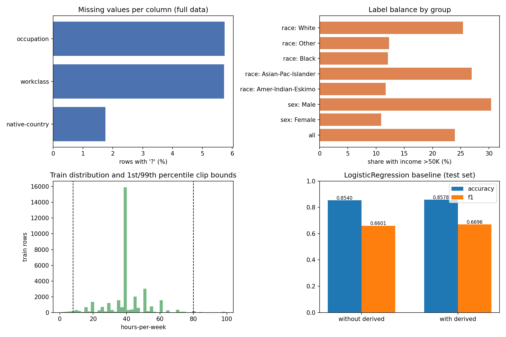

# Lab 4 – Data Pipeline and Quality

## 1. Goal

Build a reproducible, leakage-free data pipeline for the UCI Adult (Census Income) dataset. The pipeline validates the raw data against an explicit schema without dropping anything silently. It cleans and transforms the data with statistics learned from the training split only, and it tests two engineered features. It also audits label quality and records a SHA256 hash of the processed data together with its configuration. The whole pipeline runs with one command.

### Problem definition

- **Task.** Binary classification: predict whether a person's annual income is above \$50K from census attributes.
- **Inputs.** 14 features. Six are numeric: age, fnlwgt, education-num, capital-gain, capital-loss, hours-per-week. Eight are categorical: workclass, education, marital-status, occupation, relationship, race, sex, native-country.
- **Output.** `income`, with `>50K` as the positive class and `<=50K` as the negative class.
- **Success metrics.** Accuracy and F1 on the held-out test set. F1 is the main metric: only 23.9 % of the rows are positive, so a model that always predicts `<=50K` would already reach about 76 % accuracy while being useless.
- **Constraints.**
  - *No leakage.* The test set is split off before any cleaning, and every learned statistic (medians, modes, percentiles, scaling, category lists) comes from the training split only.
  - *Reproducibility.* The pipeline uses fixed seeds and a versioned configuration file, runs with one command, and stores a hash of its output so that a rerun can be verified.
  - *No silent changes.* Validation only reports problems; rows are removed only by the documented train-only deduplication step.
- **Use.** The data comes from the 1994 US Census and contains sensitive attributes (sex, race, native country). Any model trained on it is for studying the pipeline, not for real decisions about people (see `data_card.md`).

## 2. Method

The whole pipeline runs with one command, `python lab04/src/run_all.py` (or `python lab04/src/pipeline.py` without the version printout). Settings are read from `lab04/config.yaml` with PyYAML.

| Step | Script | What it does |
|---|---|---|
| Ingestion | `ingest.py` | `fetch_openml(name='adult', version=2, as_frame=True)`. Keeps an untouched copy in `data/raw/` and logs the row and column counts plus the hash of the raw data. OpenML already stores `?` as a missing value. The pipeline writes missing categories back as `?` to follow the lab's null policy; no row is removed and no value is changed. |
| Validation | `validate.py` | Checks the schema (15 columns, int/category types), the value ranges, missing values (`?` is allowed but counted), the label values and duplicates. Writes `results/validation_report.md` and `.csv`. Only reports problems. |
| Split | `pipeline.py` | 70/30 stratified split on `income`, `random_state=42`, done **before** any cleaning. |
| Cleaning | `pipeline.py` | Exact duplicates are dropped from the training split only. The test split is left untouched. |
| Transformation | `preprocess.py` | Fitted on train only. Numeric columns: median imputation, clipping to the train 1st/99th percentiles, standard scaling. Categorical columns: mode imputation of `?`, one-hot encoding (categories unseen in train are ignored). The fitted pipeline is saved to `results/preprocessor.joblib`. |
| Derived features | `preprocess.py` | `capital_net = capital-gain − capital-loss` and `hours_per_age = hours-per-week / (age − 16)`. Both are computed row by row and learn nothing, so they cannot leak. They are then imputed, clipped and scaled like the other numeric columns. |
| Feature experiment | `pipeline.py` | `LogisticRegression(max_iter=1000)` trained with and without the derived features; accuracy and F1 on the test split. |
| Label audit | `label_quality.py` | Duplicate-conflict audit: groups of identical 14-feature rows whose income labels disagree. Re-check of 50 random rows (`random_state=42`) against the data dictionary. |
| Hash and config | `pipeline.py` | SHA256 of the processed train and test sets (canonical CSV: fixed column order, 6 decimals, `\n` line endings). Stored in `results/run_config.yaml` together with the full configuration. |

The data-dictionary rules used in the 50-row re-check (and also run on the full data for context):

- the four value ranges from the schema;
- `education` must match `education-num` (e.g. Bachelors = 13);
- capital-gain and capital-loss must not both be positive;
- a Husband must be Male and a Wife must be Female;
- Husband/Wife requires a "Married-…" marital status;
- Never-worked must have no occupation;
- the label must be `<=50K` or `>50K`.

## 3. Results

### Ingestion (`results/ingestion_log.json`)

48,842 rows × 15 columns, as expected. Raw-data SHA256: `8f970e20c9991979ec0a9ccb65ce97543d678709a2c6f8ef23f7fb32f40adddc`.

### Validation report (`results/validation_report.md`)

All 37 checks pass. No value is outside the schema, and no row was dropped at this stage. The findings that matter for cleaning:

| Check | Result |
|---|---|
| Schema | 15/15 columns; the 6 numeric columns are int64 whole numbers; the 9 categorical columns are category dtype |
| Ranges | age 17–90, hours-per-week 1–99, capital-gain 0–99,999, capital-loss 0–4,356; observed min/max equal the limits exactly, 0 violations |
| Missing (`?`) | workclass 2,799 (5.73 %), occupation 2,809 (5.75 %), native-country 857 (1.75 %); all other columns 0 |
| Labels | only `<=50K` / `>50K`; positive rate 23.93 % |
| Exact duplicate rows | 52 |
| Duplicate feature rows (label ignored) | 57 |

The observed maximum of capital-gain is exactly 99,999, the upper limit of the schema. This is a top-coding value from the census, not a real income, and the clipping step deals with it.

### Cleaning and transformation (`results/run_config.yaml`, `results/fitted_*.csv`)

- **Split.** 34,189 train / 14,653 test. 24 exact duplicates were dropped from train, leaving 34,165 rows; the test split is unchanged.
- **Learned statistics.** Every value below was learned from the training split only:
  - *Medians:* age 37, hours-per-week 40, capital-gain 0.
  - *Modes:* workclass Private, occupation Prof-specialty, native-country United-States.
- **Clip bounds (1st/99th percentile of train).**
  - age 17–74
  - hours-per-week 8–80
  - capital-gain 0–15,024 (this removes the 99,999 top-code)
  - capital-loss 0–1,980
  - capital_net −1,980–15,024
  - hours_per_age 0.21–20
- **Output.** The processed data has 107 feature columns plus the label.

### Derived features (`results/feature_experiment.csv`)

| Derived features | Features after encoding | Test accuracy | Test F1 |
|---|---|---|---|
| no | 105 | 0.8540 | 0.6601 |
| yes | 107 | **0.8578** | **0.6696** |

Adding the two features improves accuracy by 0.38 points and F1 by 0.95 points. For a linear model, `capital_net` puts gains and losses on one axis. `hours_per_age` adds an interaction (hours relative to working age) that a linear model cannot build from the separate columns.

### Label-quality audit (`results/label_audit.json`, `label_conflicts.csv`, `label_audit_sample_50.csv`)

| Check | Result |
|---|---|
| Groups of identical 14-feature rows | 54 groups, 111 rows |
| **Groups with conflicting income labels** | **5 groups, 10 rows** |
| 50 random rows vs. data dictionary | 0 of 50 with an issue |
| Same rules on all 48,842 rows | 4 rows: relationship vs. sex (Husband recorded as Female or Wife as Male) |

All 5 conflicting groups are pairs that agree on all 14 features, including the very specific `fnlwgt`, but have different income labels. Such a pair is either two different people who happen to share every attribute, or one record that was labelled inconsistently. A model cannot fit both labels, so these 10 rows put a small floor under the achievable error. They are kept and reported rather than "fixed", because the data gives no way to tell which label is correct.

The 50-row sample is saved with an `issues` column so it can be reviewed by hand. It contained no impossible values. Across the full data the dictionary checks found only 4 inconsistent rows, so the dataset is internally very clean; its quality problems are missing values, duplicates and top-coding rather than wrong entries.

### Data-quality overview (`results/data_quality.png`)

### Hash and configuration (`results/run_config.yaml`)

- Processed train SHA256: `253cc30268f71e65c87aa11abb131c2ce0bea34fca999719277f66f71782b862`
- Processed test SHA256: `ee20c623b9330724f50ec06c25618be45c1e249ea66752de6719428be3e803b7`
- Combined: `20c9dd09b20b799a0bb43da863c49661bd562fb633058f12aeee4a0c71fe9315`

Running the same command with the same `config.yaml` and package versions must reproduce these hashes. If one hash differs, then the data, the code or the configuration has changed.

The data card is in [`data_card.md`](data_card.md).

## 4. Conclusions

1. **The order of the steps is what prevents leakage.** If the median, the mode, the 1st/99th percentiles and the scaler had been fitted before the split, the test rows would have shaped the training features. The resulting test score would no longer be an honest estimate. Splitting first and fitting everything inside one saved pipeline makes this impossible by construction. The same saved object can then be applied to new data without recomputing anything.
2. **Validation should report, not repair.** The raw data passes every schema and range check, but the report still exposes what needs handling: about 6 % missing workclass/occupation, 52 duplicate rows, the 99,999 top-code in capital-gain, and 5 pairs of identical people with opposite labels. Writing these down instead of silently dropping rows keeps every later decision visible and reversible.
3. **Simple, leakage-free features can still help, and a hash makes the result checkable.** Two row-wise features raised F1 from 0.660 to 0.670 without touching the test set. The SHA256 of the processed data, stored next to the configuration that produced it, turns "it worked on my machine" into a verifiable claim: anyone can rerun the one command and compare the hash.
