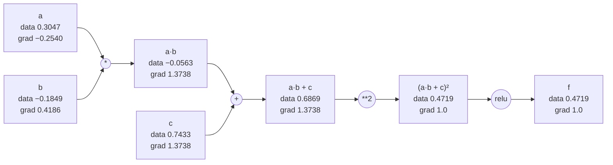
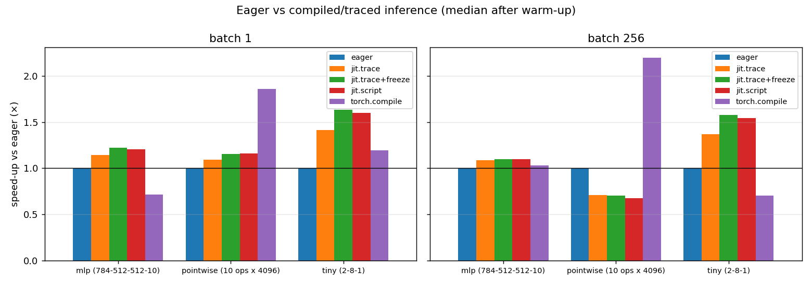
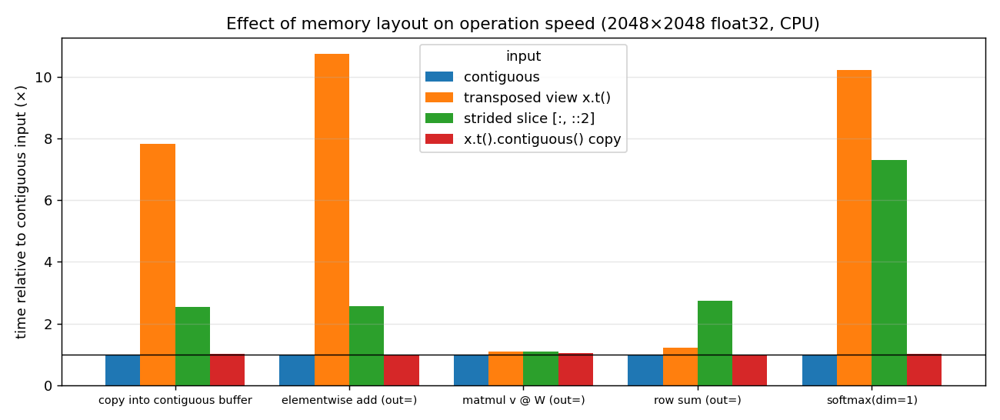

# Lab 5 – Frameworks and Automatic Differentiation

**Student:** Fatih Alkan (79731)

## 1. Goal

Build the core of a deep-learning framework by hand: a scalar reverse-mode automatic-differentiation engine that records a computation graph during the forward pass and runs back-propagation over it. The engine is verified against PyTorch autograd and against numerical gradients, and it is used to train a small network on `make_moons`, where its speed is compared with PyTorch. The second half of the lab looks at the framework side: how PyTorch represents the graph, what eager vs compiled/traced execution costs, and how the memory layout of a tensor (contiguous or not) changes the speed of an operation.

Reading: Reddi, Ch. 7 *AI Frameworks* (§7.3 computation graphs and automatic differentiation, §7.4 framework architecture and execution modes, §7.6 system integration, §§7.7–7.8 implementation and deployment).

## 2. Method

All steps run with one command: `python lab05/src/run_all.py`.

**Measurement environment.** The results in this report were produced with the pinned environment of `requirements.txt` (Python 3.11.8, torch 2.3.1 CPU build) on a GitHub-hosted Linux runner: Intel Xeon Platinum 8370C, 2 physical cores / 4 logical CPUs, 16 GB RAM, PyTorch using 2 threads (`results/versions.txt`). The workflow is `.github/workflows/run-labs.yml`. Absolute times differ from my laptop used in Labs 1–4; the comparisons inside this lab all come from the same machine and the same process. On Linux, `torch.compile` is supported, so the comparison includes it next to the TorchScript modes.

| Step | Script | Output |
|---|---|---|
| 1–3 | `src/engine.py` – the `Value` node, the operations and `backward()` | – |
| 4 | `src/gradcheck.py` | `results/gradcheck.csv`, `results/gradcheck_summary.csv`, `results/graph_example.dot`, `results/graph_stats.txt` |
| 5 | `src/engine_nn.py`, `src/train_moons.py` | `results/moons_loss_curves.csv`, `results/moons_timing.csv`, `results/moons_training.png` |
| 6 | `src/torch_graph.py` | `results/graph_inspection.txt`, `results/eager_vs_compiled.csv/.png`, `results/contiguity.csv/.png` |
| – | `src/print_versions.py` | `results/versions.txt` |

### 2.1 The `Value` node (step 1)

A `Value` is one node of the computation graph. It stores exactly the four things the manual asks for:

| Field | Meaning |
|---|---|
| `data` | the scalar result of the forward computation (Python `float`, i.e. float64) |
| `grad` | ∂output/∂this node, filled in by the backward pass (starts at 0) |
| `_parents` | the nodes this value was computed from (the incoming edges of the graph) |
| `_backward` | a closure with the **local derivative rule**: it takes `out.grad` and adds `local_derivative × out.grad` to every parent |

Two more fields are only for inspection: `_op` (the name of the operation) and `label`. `__slots__` keeps every node small, because training creates more than 13,000 nodes per step (section 3.2).

### 2.2 Operations and graph construction (step 2)

Every operation creates a new `Value` whose parents are its operands, so running the forward pass *is* building the graph (define-by-run, like PyTorch's eager mode, Ch. 7.3).

| Operation | Forward | Local rule in `_backward` |
|---|---|---|
| `a + b` | a + b | `a.grad += out.grad`, `b.grad += out.grad` |
| `a * b` | a · b | `a.grad += b · out.grad`, `b.grad += a · out.grad` |
| `a ** k` (constant k) | aᵏ | `a.grad += k · aᵏ⁻¹ · out.grad` |
| `a.relu()` | max(a, 0) | `a.grad += 1[a > 0] · out.grad` (sub-gradient 0 at a = 0, same as PyTorch) |

Subtraction, negation, division and the reflected operators (`2 * a`, `1 - a`, …) are built from these four, so they need no rule of their own. For step 5 I also added `exp`, `log` and a numerically stable `sigmoid` (σ′ = σ(1 − σ)). Python numbers that appear in an expression are wrapped into constant leaf nodes automatically.

### 2.3 Backward pass (step 3)

`backward()` follows the four required steps:

1. **Topological sort.** An iterative depth-first search returns every node after all of its parents. (A recursive version hits Python's recursion limit on the long sum chains of the training graph.)
2. **Seed.** All gradients are reset to 0, then the output's gradient is set to 1 (∂f/∂f = 1).
3. **Reverse order.** The nodes are visited from the output back to the leaves, so a node's `_backward` runs only after *all* nodes that use it have added their contribution to its `grad`.
4. **Accumulate, never overwrite.** Every rule uses `+=`. If a node feeds several later nodes (e.g. `e` in `e*e + e`), its gradient is the *sum* of the contributions of all paths (multivariate chain rule). With `=` only the last path would survive, and the "reuse" test below would fail.

The graph for a single element of the step-4 expression, with the values and gradients the engine computes (a = 0.3047, b = −0.1849, c = 0.7433, the first elements of the seed-42 test tensors):

Hand check with the chain rule: ∂f/∂c = 2(ab + c) = 2 · 0.6869 = 1.3738, ∂f/∂a = 2(ab + c) · b = −0.2540 and ∂f/∂b = 2(ab + c) · a = 0.4186. These are exactly the values in the graph (`results/graph_stats.txt`, Graphviz source in `results/graph_example.dot`).

### 2.4 Verification (step 4)

`a`, `b` and `c` are 4 × 5 float64 tensors drawn from N(0, 1) with seed 42. The expression `((a*b + c)**2).relu().sum()` is written three times: with `Value` objects, with PyTorch tensors (`requires_grad=True`, float64) and with plain Python floats. The numerical gradient is the central difference (f(x + h) − f(x − h)) / 2h with h = 10⁻⁶, done for each of the 60 inputs separately. The criterion is a maximum absolute difference below 10⁻⁶.

Note that `(a*b + c)**2` is never negative, so the `relu` is always in its identity branch in this expression. To also test the ReLU's zero branch and gradient accumulation, two extra tests are run:

- **reuse:** `e = a*b; f = Σ(e·e + e + relu(e − c))`. Every `e` is used four times and `relu(e − c)` is negative for about half of the elements.
- **all ops:** `f = Σ(sigmoid(a) · log(b² + 1) + exp(−c) / (a² + 1) − c³)`, which uses every operation of the engine, including division and a negative power.

### 2.5 Training on make_moons (step 5)

| Setting | Value |
|---|---|
| Data | `make_moons(n_samples=200, noise=0.1, random_state=42)` |
| Network | 2 → Linear(2, 8) → ReLU → Linear(8, 1) → sigmoid (33 parameters) |
| Loss | mean binary cross-entropy |
| Optimiser | full-batch gradient descent, lr 1.0, 300 epochs |
| Initialisation | U(−1/√fan_in, 1/√fan_in), the PyTorch `nn.Linear` default, from `random.Random(42)` |

The PyTorch model (`nn.Sequential(Linear, ReLU, Linear, Sigmoid)`, `BCELoss`, `SGD(lr=1.0)`) receives a **copy of the engine's initial weights**, so both implementations should follow the same trajectory and their loss curves can be compared epoch by epoch. Speed: each complete 300-epoch training run is repeated 5 times after one warm-up run; the median is reported. PyTorch is timed in float64 (same precision as the engine) and in float32 (its default).

### 2.6 PyTorch graphs, compilation and memory layout (step 6)

- **Graph inspection** of a small MLP (784 → 128 → 64 → 10): the module tree, the static `torch.fx` graph, the dynamic autograd graph that the forward pass records (walked through `grad_fn.next_functions`) and the TorchScript IR from `torch.jit.trace`. Shape, dtype, stride and contiguity of the input, the parameters and several views are printed.
- **Eager vs compiled.** `torch.compile` is tried first. torch 2.3.1 does not support `torch.compile` on Windows, so in that case the error is recorded and the manual's fallback is used: `torch.jit.trace`, `torch.jit.trace` + `torch.jit.freeze` and `torch.jit.script`. Three models with a different balance of work are measured at batch 1 and batch 256: the tiny 2-8-1 network (almost no arithmetic), a matmul-heavy MLP 784-512-512-10 and a chain of 10 element-wise operations on 4096 features (memory-bound). Every mode gets 20 warm-up calls before the median of 200 (batch 1) or 50 (batch 256) calls under `torch.no_grad()`; the first call is timed separately because it includes tracing/compilation. Outputs are checked against eager mode.
- **Non-contiguous tensors.** The same operations (element-wise, row sum, softmax, matmul, `.contiguous()`) are run on a contiguous 2048 × 2048 float32 tensor, its transpose `x.t()` (a view with swapped strides), a strided slice `x[:, ::2]` of a 2048 × 4096 tensor and a `.contiguous()` copy of the transpose. Median of 20 runs (5 for matmul) after 3 warm-ups.

## 3. Results

### 3.1 Gradient check (`results/gradcheck_summary.csv`)

| Test | f | max \|engine − torch\| | max \|engine − numerical\| | max \|torch − numerical\| | Pass (< 1e-6) |
|---|---|---|---|---|---|
| main: `((a*b+c)**2).relu().sum()` | 24.90 | **0** | 3.1e-09 | 3.1e-09 | ✅ |
| reuse: `Σ(e·e + e + relu(e−c))` | 18.21 | 1.1e-16 | 2.0e-09 | 2.0e-09 | ✅ |
| all ops: sigmoid, log, exp, div, pow | 18.51 | 2.2e-16 | 1.4e-09 | 1.4e-09 | ✅ |

The engine and PyTorch autograd agree to the last bit on the main expression and within one or two units of float64 rounding (≈ 1e-16) on the other two. Both differ from the central finite difference by ≈ 1e-9. That is the expected truncation + rounding error of a finite difference with h = 1e-6: the error is that of the numerical estimate, not of either autograd. All 60 per-element gradients of the main test are listed in `results/gradcheck.csv`. The required tolerance of 1e-6 is met with a margin of more than six orders of magnitude for PyTorch and almost three for the numerical check.

The "reuse" test is the one that proves step 3's *accumulate, don't overwrite* rule. Its graph has 239 nodes but 298 edges (`results/graph_stats.txt`), so many nodes have more than one consumer; an engine that overwrote `grad` would keep only the last path and fail this test by O(1).

### 3.2 make_moons training (`results/moons_loss_curves.csv`, `results/moons_timing.csv`)

| Epoch | Loss (engine) | Loss (PyTorch float64) | \|difference\| | Train accuracy |
|---|---|---|---|---|
| 1 | 0.702034 | 0.702034 | 2.2e-16 | 0.535 |
| 100 | 0.221220 | 0.221220 | 1.7e-16 | 0.890 |
| 200 | 0.086781 | 0.086781 | 1.4e-17 | 0.980 |
| 300 | 0.032878 | 0.032878 | 2.8e-17 | **0.995** |

Over all 300 epochs the largest difference between the two loss curves is **4.4e-16**. With the same initial weights the engine and PyTorch follow the same optimisation trajectory, so the engine's gradients are also correct inside a real training loop (ReLU, sigmoid, log, mean, parameter update). The learned boundary separates the two moons with 1 of 200 points misclassified.

**Speed (median of 5 complete 300-epoch runs, after one warm-up run):**

| Implementation | Median (s) | ms / epoch | Relative |
|---|---|---|---|
| engine (Python floats) | 37.58 | 125.3 | **362× slower** |
| PyTorch float64 | 0.106 | 0.353 | 1.02× |
| PyTorch float32 | 0.104 | 0.346 | 1 (fastest) |

The five runs of each implementation are within 1–3 % of each other. Why the gap is so large (Ch. 7.4):

- **Granularity.** The engine creates one Python object and one closure per *scalar* operation: 13,036 nodes per step, i.e. 3.9 million nodes per run. One node costs ≈ 9.6 µs (125 ms / 13,036), almost all of it interpreter overhead: object allocation, attribute look-ups, dictionary/set operations in the topological sort, and closure calls. PyTorch represents the same step with about a dozen *tensor* operations, so the per-operation overhead is paid ~10 times per step instead of ~13,000 times, and the arithmetic runs in compiled, vectorised C++ loops.
- **Precision is irrelevant here.** float64 and float32 PyTorch take the same time (0.353 vs 0.346 ms per epoch). For a 2-8-1 network the arithmetic is tiny; the time is dispatch overhead (Python → C++ → kernel selection), not FLOPs. The same effect is behind the eager-vs-compiled results below.
- **The graph is rebuilt every step** in both implementations (define-by-run). For PyTorch that costs little because each node stands for a whole tensor operation.

### 3.3 Graph and tensor inspection (`results/graph_inspection.txt`)

PyTorch keeps three different representations of the same SmallMLP (784 → 128 → 64 → 10, 109,386 parameters):

1. **torch.fx graph (static, before execution).** Seven nodes: `placeholder x → call_module fc1 → call_function torch.relu → call_module fc2 → torch.relu → call_module fc3 → output`. It is what compilers transform; `fx` also regenerates equivalent Python code from it.
2. **Autograd graph (dynamic, recorded by the forward pass).** Walking `loss.grad_fn.next_functions` gives `SumBackward0 → AddmmBackward0 → ReluBackward0 → AddmmBackward0 → …` down to six `AccumulateGrad` leaves (the 3 weights and 3 biases). Each `nn.Linear` became one `AddmmBackward0` (bias + x · Wᵀ in one fused kernel) plus a `TBackward0` for the transposed weight view. This is the same structure as my engine's `_parents` / `_backward`, but with one node per tensor operation instead of per scalar.
3. **TorchScript IR from `torch.jit.trace`.** `prim::GetAttr` / `prim::CallMethod` for the three linears and two `aten::relu` nodes, annotated with the traced shape and strides (`Float(32, 128, strides=[128, 1])`). Tracing records only the path taken for the example input; any Python control flow would be frozen into the trace.

**Tensor metadata.** All parameters and the input are float32 and contiguous (e.g. `fc1.weight` shape (128, 784), stride (784, 1)). Views change only the metadata and share the storage:

| Tensor | Shape | Stride | Contiguous |
|---|---|---|---|
| `x` | (32, 784) | (784, 1) | yes |
| `fc1.weight.t()` | (784, 128) | (1, 784) | **no** |
| `x[:, ::2]` | (32, 392) | (784, 2) | **no** |
| `x.view(32, 28, 28).permute(0, 2, 1)` | (32, 28, 28) | (784, 1, 28) | **no** |
| `x.t().contiguous()` | (784, 32) | (32, 1) | yes (a copy) |

`x.t().view(-1)` raises *"view size is not compatible with input tensor's size and stride … Use .reshape(...) instead"*: a view can only re-interpret memory, and a transposed layout cannot be flattened without moving data. `reshape` silently makes a copy instead. Note that `nn.Linear` itself reads its weight through a transposed view (x · Wᵀ); the BLAS kernel handles that through its transpose flag, without a copy.

### 3.4 Eager vs compiled (`results/eager_vs_compiled.csv`)

Median latency in µs after warm-up (speed-up vs eager in brackets); the first call, which includes tracing/compilation, is reported separately.

| Model | Batch | eager | jit.trace | jit.trace + freeze | jit.script | torch.compile |
|---|---|---|---|---|---|---|
| tiny 2-8-1 | 1 | 26.7 | 18.9 (1.42×) | **16.3 (1.64×)** | 16.7 (1.60×) | 22.4 (1.19×) |
| tiny 2-8-1 | 256 | 34.2 | 25.0 (1.37×) | **21.7 (1.58×)** | 22.1 (1.55×) | 48.7 (0.70×) |
| MLP 784-512-512-10 | 1 | 80.0 | 70.1 (1.14×) | **65.3 (1.22×)** | 66.3 (1.21×) | 112.3 (0.71×) |
| MLP 784-512-512-10 | 256 | 1,332 | 1,224 (1.09×) | **1,212 (1.10×)** | 1,215 (1.10×) | 1,290 (1.03×) |
| pointwise, 10 ops × 4096 | 1 | 43.9 | 40.2 (1.09×) | 38.1 (1.15×) | 37.9 (1.16×) | **23.6 (1.86×)** |
| pointwise, 10 ops × 4096 | 256 | 1,958 | 2,769 (0.71×) | 2,794 (0.70×) | 2,904 (0.67×) | **891 (2.20×)** |

| First call (compile / trace cost) | jit.trace | jit.script | torch.compile |
|---|---|---|---|
| typical | 0.4 – 9 ms | 0.1 – 9 ms | **1.4 – 1.5 s** (7.2 s for the very first compile in the process) |

All compiled outputs match eager mode exactly, except `torch.compile` on the point-wise chain (max difference 9.5e-7: the fused kernel evaluates `sigmoid`/`tanh` with a different but equally valid float32 instruction sequence).

What the numbers show:

- **TorchScript (trace / script / freeze) removes Python overhead and nothing else.** It gains 1.4–1.6× on the tiny network, where the run time *is* overhead. It gains 1.1–1.2× on the MLP at batch 1 and only 1.1× at batch 256, where almost all of the 1.3 ms are spent inside the BLAS matrix multiplication that both modes call. `freeze` adds a little more by inlining the weights as constants and folding the module attribute look-ups.
- **TorchScript can even be slower.** On the point-wise chain at batch 256 all three TorchScript modes are 0.67–0.71× of eager. On the CPU the TorchScript fuser is off by default, so the ten element-wise operations still run as ten separate kernels. On top of that come the graph executor's own costs (profiling guards, separate allocations of the intermediate results). Removing the Python overhead saves only microseconds, much less than the extra cost.
- **torch.compile (Inductor) wins only where it can fuse.** On the point-wise chain it generates one fused C++/OpenMP loop. The input is read once and the output written once, instead of 10 reads + 10 writes of a 4 MB tensor, so the memory-bound chain becomes 2.2× faster at batch 256 and 1.9× at batch 1. On the MLP there is nothing to fuse (the work is three GEMMs), and its guard checks and wrapper calls make it *slower* than eager at batch 1 (0.71×) and only equal at batch 256.
- **The compile cost has to be amortised.** At 1.4 s per compile, the point-wise model at batch 256 (saving ≈ 1.07 ms per call) pays back after ≈ 1,300 calls; the tiny model at batch 1 (saving 4.3 µs) would need ≈ 1.7 million calls (the first compile in the process took 7.2 s).

### 3.5 Contiguous vs non-contiguous tensors (`results/contiguity.csv`)

2048 × 2048 float32 (16 MB), median times in ms; the factor is relative to the contiguous input. Outputs go into pre-allocated buffers (`out=`) where PyTorch allows it, so the time reflects the memory access pattern and not the allocator.

| Operation | contiguous | `x.t()` view | `[:, ::2]` slice | `x.t().contiguous()` copy |
|---|---|---|---|---|
| element-wise add | 0.67 | 7.21 (**10.7×**) | 1.72 (2.6×) | 0.64 (1.0×) |
| row sum | 0.27 | 0.33 (1.2×) | 0.74 (2.7×) | 0.27 (1.0×) |
| softmax(dim=1) | 1.48 | 15.11 (**10.2×**) | 10.82 (7.3×) | 1.50 (1.0×) |
| matmul with W | 45.4 | 49.4 (1.09×) | 49.8 (1.10×) | 47.4 (1.04×) |
| copy into contiguous buffer | 0.64 | 5.03 (7.8×) | 1.63 (2.5×) | 0.66 (1.0×) |

- **Element-wise operations and softmax suffer most (≈ 10×).** For the transposed view, consecutive elements of a row are 2048 floats = 8 KB apart in memory. Every element touched pulls in a whole 64-byte cache line of which 4 bytes are used, the hardware prefetcher cannot follow the pattern, and the vectorised (AVX) fast path of the kernel is not taken. The strided slice is cheaper (2.5–7×) because its stride is only 2 elements, so every cache line is still half used.
- **Matrix multiplication barely notices (≤ 1.1×).** A BLAS GEMM copies (packs) its input blocks into a cache-friendly layout anyway, and it accepts transposed operands through a flag. So a non-contiguous input costs only the packing, which is small compared to the O(n³) arithmetic.
- **Reductions depend on the direction.** Summing along dim 1 of the transposed view reads columns of the original, which PyTorch's reduction kernel can still vectorise across rows (1.2×). The `::2` slice forces a gather on every element (2.7×).
- **Paying for one copy is often worth it.** Making the transposed view contiguous costs 5.0 ms. For softmax, copy + contiguous softmax = 5.0 + 1.5 = 6.5 ms, against 15.1 ms on the view, a 2.3× win. For a single cheap element-wise operation the copy is not worth it (5.0 + 0.6 ≈ 7.2 ms). For several operations on the same tensor it clearly is.

## 4. When does compilation help?

Compilation pays off when **all** of the following hold:

1. **The run time is dominated by overhead or by memory traffic, not by one big library kernel.** Small layers, many small element-wise operations, normalisation and activation chains are fusable; Inductor turned 10 memory-bound passes into one and gained 2.2×. A model whose time is inside GEMMs or convolutions (the MLP at batch 256) is already running vendor-optimised code, so there is little left to gain (1.03–1.10×).
2. **The model is called many times with the same shapes.** `torch.compile` cost 1.4–7 s per graph here, so it is worth it for a serving process or a long training run, but not for a script that runs a model a few times. New input shapes (a different batch size) trigger a recompilation unless dynamic shapes are enabled.
3. **The graph is static enough.** Data-dependent Python control flow causes graph breaks (torch.compile) or is silently frozen into the trace (`jit.trace`); `jit.script` handles it but restricts the Python that can be used.

When the overhead is the problem but nothing can be fused, a cheap TorchScript trace + `freeze` already removes most of the Python cost (1.6× on the tiny network, 1.2× on the MLP at batch 1) at a compile cost of under 10 ms. When neither applies, eager mode is the right choice. Eager is also what makes debugging, printing intermediate tensors and data-dependent logic easy, which is why it is PyTorch's default (Ch. 7.4).

## 5. Conclusions

1. **Reverse-mode autodiff is a small algorithm on top of a graph.** A node with four fields, four local derivative rules, a topological sort and a `+=` were enough to match PyTorch autograd to within 2e-16 and to reproduce a 300-epoch PyTorch training run to 4e-16. The essential details are the reverse topological order and *accumulating* gradients for nodes with several consumers.
2. **What makes a framework fast is granularity, not the algorithm.** My scalar engine is 362× slower than PyTorch on the same 33-parameter network because it pays the interpreter overhead per scalar (13k graph nodes per step) where PyTorch pays it per tensor operation (~12 per step). Precision made no difference (float64 ≈ float32): at this size the cost is dispatch overhead, not FLOPs.
3. **Compilation is a trade-off, not a free speed-up.** Fusion (torch.compile) gave 2.2× on a memory-bound element-wise chain, but slowed down the GEMM-bound MLP at batch 1 and needed 1.4–7 s to compile. Python-overhead removal (TorchScript) helps tiny models (1.6×) and can hurt fusable ones (0.7×).
4. **Memory layout is part of performance.** The same 4 M additions took 0.67 ms on a contiguous tensor and 7.2 ms on its transpose. Strides decide whether caches and SIMD units are used. Before a chain of element-wise or softmax operations on a transposed or strided view, one `.contiguous()` copy pays for itself; matrix multiplications do not need it.
