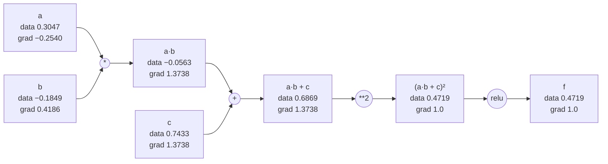
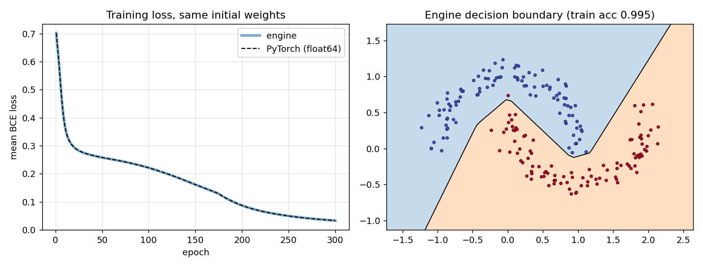

# Lab 5 – Frameworks and Automatic Differentiation

**Student:** Fatih Alkan (79731)

## 1. Goal

Build the core of a deep-learning framework by hand: a scalar reverse-mode automatic-differentiation engine that records a computation graph during the forward pass and runs back-propagation over it. The engine is verified against PyTorch autograd and against numerical gradients, and it is used to train a small network on `make_moons`, where its speed is compared with PyTorch. The second half of the lab looks at the framework side: how PyTorch represents the graph, what eager vs compiled/traced execution costs, and how the memory layout of a tensor (contiguous or not) changes the speed of an operation.

Reading: Reddi, Ch. 7 *AI Frameworks* (§7.3 computation graphs and automatic differentiation, §7.4 framework architecture and execution modes, §7.6 system integration, §§7.7–7.8 implementation and deployment).

## 2. Method

All steps run with one command: `python lab05/src/run_all.py`.

| Step | Script | Output |
|---|---|---|
| 1–3 | `src/engine.py` – the `Value` node, the operations and `backward()` | – |
| 4 | `src/gradcheck.py` | `results/gradcheck.csv`, `results/gradcheck_summary.csv`, `results/graph_example.dot`, `results/graph_stats.txt` |
| 5 | `src/engine_nn.py`, `src/train_moons.py` | `results/moons_loss_curves.csv`, `results/moons_timing.csv`, `results/moons_training.png` |
| 6 | `src/torch_graph.py` | `results/graph_inspection.txt`, `results/eager_vs_compiled.csv/.png`, `results/contiguity.csv/.png` |
| – | `src/print_versions.py` | `results/versions.txt` |

### 2.1 The `Value` node (step 1)

A `Value` is one node of the computation graph. It stores exactly the four things the manual asks for:

| Field | Meaning |
|---|---|
| `data` | the scalar result of the forward computation (Python `float`, i.e. float64) |
| `grad` | ∂output/∂this node, filled in by the backward pass (starts at 0) |
| `_parents` | the nodes this value was computed from (the incoming edges of the graph) |
| `_backward` | a closure with the **local derivative rule**: it takes `out.grad` and adds `local_derivative × out.grad` to every parent |

Two more fields are only for inspection: `_op` (the name of the operation) and `label`. `__slots__` keeps every node small, because training creates more than 13,000 nodes per step (section 3.2).

### 2.2 Operations and graph construction (step 2)

Every operation creates a new `Value` whose parents are its operands, so running the forward pass *is* building the graph (define-by-run, like PyTorch's eager mode, Ch. 7.3).

| Operation | Forward | Local rule in `_backward` |
|---|---|---|
| `a + b` | a + b | `a.grad += out.grad`, `b.grad += out.grad` |
| `a * b` | a · b | `a.grad += b · out.grad`, `b.grad += a · out.grad` |
| `a ** k` (constant k) | aᵏ | `a.grad += k · aᵏ⁻¹ · out.grad` |
| `a.relu()` | max(a, 0) | `a.grad += 1[a > 0] · out.grad` (sub-gradient 0 at a = 0, same as PyTorch) |

Subtraction, negation, division and the reflected operators (`2 * a`, `1 - a`, …) are built from these four, so they need no rule of their own. For step 5 I also added `exp`, `log` and a numerically stable `sigmoid` (σ′ = σ(1 − σ)). Python numbers that appear in an expression are wrapped into constant leaf nodes automatically.

### 2.3 Backward pass (step 3)

`backward()` follows the four required steps:

1. **Topological sort.** An iterative depth-first search returns every node after all of its parents. (A recursive version hits Python's recursion limit on the long sum chains of the training graph.)
2. **Seed.** All gradients are reset to 0, then the output's gradient is set to 1 (∂f/∂f = 1).
3. **Reverse order.** The nodes are visited from the output back to the leaves, so a node's `_backward` runs only after *all* nodes that use it have added their contribution to its `grad`.
4. **Accumulate, never overwrite.** Every rule uses `+=`. If a node feeds several later nodes (e.g. `e` in `e*e + e`), its gradient is the *sum* of the contributions of all paths (multivariate chain rule). With `=` only the last path would survive, and the "reuse" test below would fail.

The graph for a single element of the step-4 expression, with the values and gradients the engine computes (a = 0.3047, b = −0.1849, c = 0.7433, the first elements of the seed-42 test tensors):

Hand check with the chain rule: ∂f/∂c = 2(ab + c) = 2 · 0.6869 = 1.3738, ∂f/∂a = 2(ab + c) · b = −0.2540 and ∂f/∂b = 2(ab + c) · a = 0.4186. These are exactly the values in the graph (`results/graph_stats.txt`, Graphviz source in `results/graph_example.dot`).

### 2.4 Verification (step 4)

`a`, `b` and `c` are 4 × 5 float64 tensors drawn from N(0, 1) with seed 42. The expression `((a*b + c)**2).relu().sum()` is written three times: with `Value` objects, with PyTorch tensors (`requires_grad=True`, float64) and with plain Python floats. The numerical gradient is the central difference (f(x + h) − f(x − h)) / 2h with h = 10⁻⁶, done for each of the 60 inputs separately. The criterion is a maximum absolute difference below 10⁻⁶.

Note that `(a*b + c)**2` is never negative, so the `relu` is always in its identity branch in this expression. To also test the ReLU's zero branch and gradient accumulation, two extra tests are run:

- **reuse:** `e = a*b; f = Σ(e·e + e + relu(e − c))`. Every `e` is used four times and `relu(e − c)` is negative for about half of the elements.
- **all ops:** `f = Σ(sigmoid(a) · log(b² + 1) + exp(−c) / (a² + 1) − c³)`, which uses every operation of the engine, including division and a negative power.

### 2.5 Training on make_moons (step 5)

| Setting | Value |
|---|---|
| Data | `make_moons(n_samples=200, noise=0.1, random_state=42)` |
| Network | 2 → Linear(2, 8) → ReLU → Linear(8, 1) → sigmoid (33 parameters) |
| Loss | mean binary cross-entropy |
| Optimiser | full-batch gradient descent, lr 1.0, 300 epochs |
| Initialisation | U(−1/√fan_in, 1/√fan_in), the PyTorch `nn.Linear` default, from `random.Random(42)` |

The PyTorch model (`nn.Sequential(Linear, ReLU, Linear, Sigmoid)`, `BCELoss`, `SGD(lr=1.0)`) receives a **copy of the engine's initial weights**, so both implementations should follow the same trajectory and their loss curves can be compared epoch by epoch. Speed: each complete 300-epoch training run is repeated 5 times after one warm-up run; the median is reported. PyTorch is timed in float64 (same precision as the engine) and in float32 (its default).

### 2.6 PyTorch graphs, compilation and memory layout (step 6)

- **Graph inspection** of a small MLP (784 → 128 → 64 → 10): the module tree, the static `torch.fx` graph, the dynamic autograd graph that the forward pass records (walked through `grad_fn.next_functions`) and the TorchScript IR from `torch.jit.trace`. Shape, dtype, stride and contiguity of the input, the parameters and several views are printed.
- **Eager vs compiled.** `torch.compile` is tried first. torch 2.3.1 does not support `torch.compile` on Windows, so in that case the error is recorded and the manual's fallback is used: `torch.jit.trace`, `torch.jit.trace` + `torch.jit.freeze` and `torch.jit.script`. Three models with a different balance of work are measured at batch 1 and batch 256: the tiny 2-8-1 network (almost no arithmetic), a matmul-heavy MLP 784-512-512-10 and a chain of 10 element-wise operations on 4096 features (memory-bound). Every mode gets 20 warm-up calls before the median of 200 (batch 1) or 50 (batch 256) calls under `torch.no_grad()`; the first call is timed separately because it includes tracing/compilation. Outputs are checked against eager mode.
- **Non-contiguous tensors.** The same operations (element-wise, row sum, softmax, matmul, `.contiguous()`) are run on a contiguous 2048 × 2048 float32 tensor, its transpose `x.t()` (a view with swapped strides), a strided slice `x[:, ::2]` of a 2048 × 4096 tensor and a `.contiguous()` copy of the transpose. Median of 20 runs (5 for matmul) after 3 warm-ups.

## 3. Results

> Machine: see `results/versions.txt` (Python 3.11.8, torch 2.3.1, CPU).

### 3.1 Gradient check (`results/gradcheck_summary.csv`)

| Test | f | max \|engine − torch\| | max \|engine − numerical\| | Pass (< 1e-6) |
|---|---|---|---|---|
| main: `((a*b+c)**2).relu().sum()` | 24.90 | _pending local run_ | 3.1e-09 | _pending_ |
| reuse: `Σ(e·e + e + relu(e−c))` | 18.21 | _pending local run_ | 2.0e-09 | _pending_ |
| all ops | 18.51 | _pending local run_ | 1.4e-09 | _pending_ |

Per-element gradients of all 60 inputs of the main test are in `results/gradcheck.csv`.

The graph sizes (`results/graph_stats.txt`) show how quickly a scalar graph grows: the main test on 20 elements already has 159 nodes and 158 edges (60 leaves, 20 `*`, 39 `+`, 20 `**2`, 20 `relu`). In the reuse test there are more edges (298) than nodes − 1 (238): the graph is no longer a tree, which is exactly the situation where gradients have to be accumulated.

### 3.2 make_moons training (`results/moons_loss_curves.csv`, `results/moons_timing.csv`)

The engine reaches a training loss of 0.0329 and a training accuracy of 99.5 % after 300 epochs (loss 0.702 → 0.221 after 100 epochs → 0.087 after 200 → 0.033 after 300). Each training step builds a new graph of **13,036 nodes** (200 samples × about 65 nodes for the network and the loss, plus the mean).

| Implementation | Median of 5 runs (s) | ms per epoch | Relative to fastest |
|---|---|---|---|
| engine (Python floats) | _pending_ | _pending_ | _pending_ |
| PyTorch float64 | _pending_ | _pending_ | _pending_ |
| PyTorch float32 | _pending_ | _pending_ | _pending_ |

### 3.3 Eager vs compiled (`results/eager_vs_compiled.csv`)

_pending local run_

### 3.4 Graph and tensor inspection (`results/graph_inspection.txt`)

_pending local run_

### 3.5 Contiguous vs non-contiguous (`results/contiguity.csv`)

_pending local run_

## 4. When does compilation help?

_pending local run_

## 5. Conclusions

_pending local run_
