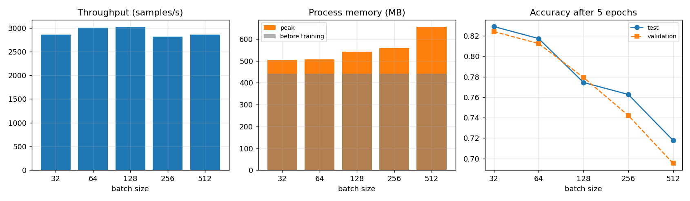
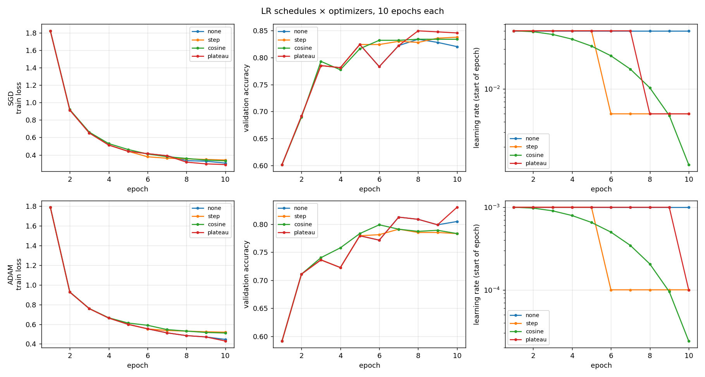
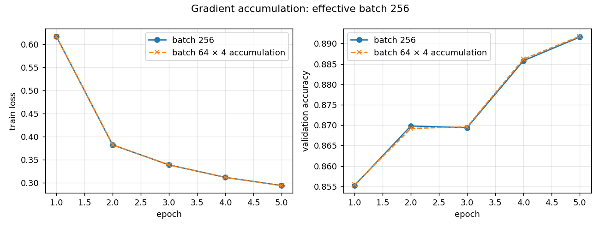
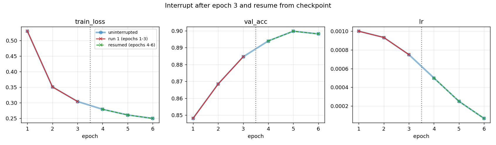

# Lab 6 – Training Pipelines and Project Proposal

**Student:** Fatih Alkan (79731)

## 1. Goal

Turn the best model of Lab 3 (the CNN, 89.2 % test accuracy on Fashion-MNIST) into a reproducible training pipeline that is driven by one YAML configuration, saves checkpoints, and logs every run to MLflow. The pipeline is then used as a measurement tool: a profile of one epoch shows where the time goes, and four studies analyse the system trade-offs of training — DataLoader workers, batch size, optimizer and learning-rate schedule, and gradient accumulation. Finally, an interrupted run is resumed from a checkpoint, and the individual project proposal is written.

Reading: Reddi, Ch. 8 *AI Training* (training-system architecture, data loading, optimization, profiling, §8.7 optimization techniques), Ch. 5 §5.5 *Model Development* and Ch. 13 §13.3 *MLOps key components* (experiment tracking, reproducibility).

## 2. Method

Everything runs with `python lab06/src/run_all.py`; every step can also be run alone.

| Step | Script | Output |
|---|---|---|
| 1 | `config.yaml`, `src/config.py`, `src/train.py` | `results/history/baseline_*`, MLflow run `baseline` |
| 2 | `src/profile_epoch.py` | `results/profile_breakdown.csv/.png`, `results/profile_top_ops.txt` |
| 3 | `src/study_workers.py` | `results/workers_study.csv/.png` |
| 4 | `src/study_batch.py` | `results/batch_study.csv/.png` |
| 5 | `src/study_schedules.py` | `results/schedule_study.csv/.png` |
| 6 | `src/study_accumulation.py` | `results/accumulation_gradcheck.csv`, `results/accumulation_study.csv/.png` |
| 7 | `src/study_resume.py` | `results/resume_study.csv/.png` |
| 8 | `proposal.md` | the one-page project proposal |
| – | `src/export_mlflow.py` | `results/mlflow_runs.csv` (all MLflow runs) |

### 2.1 Config-driven training script (step 1)

**One configuration object.** `lab06/config.yaml` holds every setting of a run in nine sections: `experiment`, `seed`, `data`, `model`, `optimizer`, `scheduler`, `training`, `checkpoint`, `mlflow`. `src/config.py` loads it with PyYAML into a `Config` object (a dict with attribute access, `cfg.optimizer.lr`). A study never edits the file; it changes single keys on the command line, and the value is parsed as YAML so types stay correct:

```bash
python lab06/src/train.py --run-name sgd_cosine \
    --set optimizer.name=sgd --set optimizer.lr=0.05 --set scheduler.name=cosine
```

Unknown keys raise an error instead of being silently added, so a typo cannot create a run with a setting that does nothing.

**Model and data.** Exactly the Lab 3 CNN (Conv 1→16 → ReLU → MaxPool → Conv 16→32 → ReLU → MaxPool → Linear 1568→10, 20,490 parameters) and the same data: Fashion-MNIST, `ToTensor` + `Normalize(0.2860, 0.3530)`, 55k/5k train/validation split with seed 42, official 10k test set.

**Reproducibility.**
- `random`, `numpy` and `torch` are seeded from `cfg.seed`; the shuffling of the training loader uses its own `torch.Generator` seeded with the same value.
- The full configuration is written next to the results (`results/history/<run>_config.yaml`) and logged to MLflow.
- Every process logs Python and package versions (`results/versions.txt`).

**Checkpoints.** After every epoch `checkpoints/<run>/epoch_NN.pt` stores the model, optimizer and scheduler state, the history so far, the configuration, the MLflow run id and **all random-number-generator states** (Python, NumPy, torch and the DataLoader generator). With the generator state, a resumed run draws exactly the same shuffling order as an uninterrupted one.

**MLflow.** Local file store in `lab06/mlruns` (`mlflow ui --backend-store-uri lab06/mlruns`).
- *Params:* every config value, flattened (`optimizer.lr`, `data.batch_size`, … – 30 params).
- *Metrics per epoch:* `lr`, `train_loss`, `train_acc`, `val_loss`, `val_acc`, `epoch_time_s`, `throughput_samples_s`; at the end `test_loss`, `test_acc`, `peak_memory_mb`.
- *Artifacts:* the config YAML, the per-epoch history CSV, a JSON summary and the final checkpoint.
- *Tags:* run name and lab step (`1-baseline`, `4-batch-size`, …).
- The studies that do not train (profiling, worker study) are logged as runs too. All runs are exported to `results/mlflow_runs.csv`, because the MLflow store itself is not committed.

**Training loop.** Cross-entropy loss, optimizer `adam` or `sgd` (+ momentum), schedule `none`, `step`, `cosine` or `plateau` (stepped once per epoch; `plateau` monitors the validation loss). Throughput is measured over the training loop only (validation excluded). The peak memory of the process is read from the OS (Windows: peak working set, Linux: max RSS).

### 2.2 Profiling (step 2)

One epoch (430 steps of batch 128, `num_workers = 0`) runs under `torch.profiler` (CPU activity). Each step is split into four labelled regions with `record_function`: `data_loading` (`next(iterator)`: reading, `ToTensor`, `Normalize`, collation), `forward` (model + loss), `backward` (`zero_grad` + `loss.backward()`) and `optimizer_step`. The profiler's CPU time per region gives the share. The same regions are also timed with `perf_counter`, in the profiled epoch and in a second epoch without the profiler, to see how much the profiler changes the picture.

### 2.3 DataLoader workers (step 3)

For `num_workers ∈ {0, 1, 2, 4, 8}`: time until the first batch (worker start-up), one full pass over the loader without any model work (data-only time), and one real training epoch. As a reference, one epoch is trained on batches that were decoded in advance and kept in memory (compute-only time). Comparing the epoch time with these two bounds shows which side is the bottleneck.

### 2.4 Batch size (step 4)

Batch size ∈ {32, 64, 128, 256, 512}, 5 epochs each, Adam with the **same** learning rate 1e-3 for all sizes (so larger batches also mean fewer updates: 1,719 steps per epoch at batch 32 vs. 108 at batch 512). Every run is a separate process, so its peak memory is its own.

### 2.5 Optimizers and learning-rate schedules (step 5)

10-epoch budget for every run, batch 128.

| | SGD + momentum 0.9 | Adam |
|---|---|---|
| Initial lr | 0.05 | 1e-3 |
| constant (reference) | ✓ | ✓ |
| StepLR (× 0.1 after epoch 5) | ✓ | ✓ |
| CosineAnnealingLR (T_max = 10, η_min = 0) | ✓ | ✓ |
| ReduceLROnPlateau (× 0.1, patience 1, on val loss) | ✓ | ✓ |

### 2.6 Gradient accumulation (step 6)

Batch 64 with 4 accumulation steps should behave like batch 256. In `train.py` the optimizer steps only every `grad_accum_steps` micro-batches, and each micro-batch loss is multiplied by *(micro-batch size / size of its optimizer step's effective batch)*. With equal micro-batches this is the usual `loss / 4`. The exact weight also handles the last, smaller group correctly. The accumulated gradient is then *exactly* the gradient of the mean loss over the effective batch.

Two checks:
1. **One step:** the gradient of the first 256 training images as one batch vs. 4 weighted micro-batches of 64.
2. **Training:** batch 256 / accumulation 1 vs. batch 64 / accumulation 4, 5 epochs each. PyTorch's `RandomSampler` draws one permutation per epoch independent of the batch size, so with the same generator both runs see the same 256 images in every optimizer step: 55,000 = 214 × 256 + 216 gives 215 steps per epoch in both runs, with the same group sizes.

### 2.7 Interrupt and resume (step 7)

6 epochs, Adam 1e-3 with a cosine schedule (T_max = 6), so the scheduler state matters too. A reference run trains 6 epochs without stopping. A second run stops after epoch 3 (`--stop-after 3`, simulating a crash), and a **new process** resumes from `checkpoints/resume_interrupted/epoch_03.pt` (`--resume`). It continues the same MLflow run and the same history.

## 3. Results

> Machine and versions: `results/versions.txt`.

### 3.1 Baseline run (step 1)

_pending local run_

### 3.2 Profile of one epoch (step 2)

_pending local run_


### 3.3 num_workers (step 3)

_pending local run_


### 3.4 Batch size (step 4)

_pending local run_



### 3.5 Schedules and optimizers (step 5)

_pending local run_



### 3.6 Gradient accumulation (step 6)

_pending local run_



### 3.7 Resume from checkpoint (step 7)

_pending local run_



### 3.8 MLflow runs

_pending local run_

## 4. Project proposal (step 8)

The one-page proposal is in [proposal.md](proposal.md): **real-time traffic-sign recognition (GTSRB, 43 classes)** for a low-cost driver-assistance camera. Targets: ≥ 97 % top-1 accuracy and ≥ 0.95 macro-F1 under the deployment constraints **latency ≤ 50 ms** (batch 1, single CPU thread, p95) and **size ≤ 5 MB**. The planned optimization is knowledge distillation from a ResNet-style teacher into a ≈ 200k-parameter student, followed by int8 post-training quantization.

## 5. Conclusions

_pending local run_
