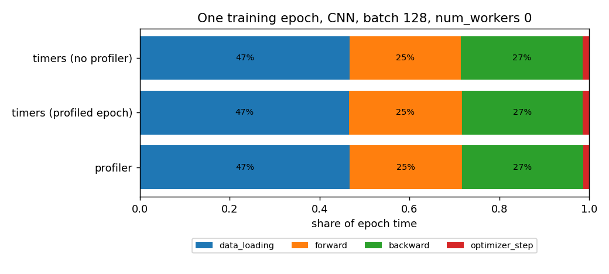
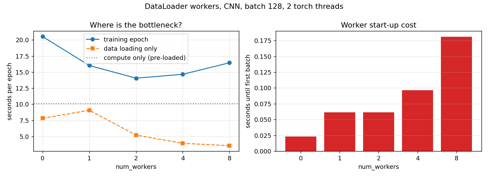

# Lab 6 – Training Pipelines and Project Proposal

**Student:** Fatih Alkan (79731)

## 1. Goal

Turn the best model of Lab 3 (the CNN, 89.2 % test accuracy on Fashion-MNIST) into a reproducible training pipeline that is driven by one YAML configuration, saves checkpoints, and logs every run to MLflow. The pipeline is then used as a measurement tool: a profile of one epoch shows where the time goes, and four studies analyse the system trade-offs of training — DataLoader workers, batch size, optimizer and learning-rate schedule, and gradient accumulation. Finally, an interrupted run is resumed from a checkpoint, and the individual project proposal is written.

Reading: Reddi, Ch. 8 *AI Training* (training-system architecture, data loading, optimization, profiling, §8.7 optimization techniques), Ch. 5 §5.5 *Model Development* and Ch. 13 §13.3 *MLOps key components* (experiment tracking, reproducibility).

## 2. Method

Everything runs with `python lab06/src/run_all.py`; every step can also be run alone.

**Measurement environment.** All numbers below come from one run of `run_all.py` with the pinned environment (Python 3.11.8, torch 2.3.1 CPU build, mlflow 2.14.1) on a GitHub-hosted Linux runner: AMD EPYC 7763, 2 physical cores / 4 logical CPUs, 16 GB RAM, 2 PyTorch threads (`results/versions.txt`, workflow `.github/workflows/run-labs.yml`). The full run took about 54 minutes. Absolute times are specific to this machine; all comparisons were made on it.

| Step | Script | Output |
|---|---|---|
| 1 | `config.yaml`, `src/config.py`, `src/train.py` | `results/history/baseline_*`, MLflow run `baseline` |
| 2 | `src/profile_epoch.py` | `results/profile_breakdown.csv/.png`, `results/profile_top_ops.txt` |
| 3 | `src/study_workers.py` | `results/workers_study.csv/.png` |
| 4 | `src/study_batch.py` | `results/batch_study.csv/.png` |
| 5 | `src/study_schedules.py` | `results/schedule_study.csv/.png` |
| 6 | `src/study_accumulation.py` | `results/accumulation_gradcheck.csv`, `results/accumulation_study.csv/.png` |
| 7 | `src/study_resume.py` | `results/resume_study.csv/.png` |
| 8 | `proposal.md` | the one-page project proposal |
| – | `src/export_mlflow.py` | `results/mlflow_runs.csv` (all MLflow runs) |

### 2.1 Config-driven training script (step 1)

**One configuration object.** `lab06/config.yaml` holds every setting of a run in nine sections: `experiment`, `seed`, `data`, `model`, `optimizer`, `scheduler`, `training`, `checkpoint`, `mlflow`. `src/config.py` loads it with PyYAML into a `Config` object (a dict with attribute access, `cfg.optimizer.lr`). A study never edits the file; it changes single keys on the command line, and the value is parsed as YAML so types stay correct:

```bash
python lab06/src/train.py --run-name sgd_cosine \
    --set optimizer.name=sgd --set optimizer.lr=0.05 --set scheduler.name=cosine
```

Unknown keys raise an error instead of being silently added, so a typo cannot create a run with a setting that does nothing.

**Model and data.** Exactly the Lab 3 CNN (Conv 1→16 → ReLU → MaxPool → Conv 16→32 → ReLU → MaxPool → Linear 1568→10, 20,490 parameters) and the same data: Fashion-MNIST, `ToTensor` + `Normalize(0.2860, 0.3530)`, 55k/5k train/validation split with seed 42, official 10k test set.

**Reproducibility.**
- `random`, `numpy` and `torch` are seeded from `cfg.seed`; the shuffling of the training loader uses its own `torch.Generator` seeded with the same value.
- The full configuration is written next to the results (`results/history/<run>_config.yaml`) and logged to MLflow.
- Every process logs Python and package versions (`results/versions.txt`).

**Checkpoints.** After every epoch `checkpoints/<run>/epoch_NN.pt` stores the model, optimizer and scheduler state, the history so far, the configuration, the MLflow run id and **all random-number-generator states** (Python, NumPy, torch and the DataLoader generator). With the generator state, a resumed run draws exactly the same shuffling order as an uninterrupted one.

**MLflow.** Local file store in `lab06/mlruns` (`mlflow ui --backend-store-uri lab06/mlruns`).
- *Params:* every config value, flattened (`optimizer.lr`, `data.batch_size`, … – 30 params).
- *Metrics per epoch:* `lr`, `train_loss`, `train_acc`, `val_loss`, `val_acc`, `epoch_time_s`, `throughput_samples_s`; at the end `test_loss`, `test_acc`, `peak_memory_mb`.
- *Artifacts:* the config YAML, the per-epoch history CSV, a JSON summary and the final checkpoint.
- *Tags:* run name and lab step (`1-baseline`, `4-batch-size`, …).
- The studies that do not train (profiling, worker study) are logged as runs too. All runs are exported to `results/mlflow_runs.csv`, because the MLflow store itself is not committed.

**Training loop.** Cross-entropy loss, optimizer `adam` or `sgd` (+ momentum), schedule `none`, `step`, `cosine` or `plateau` (stepped once per epoch; `plateau` monitors the validation loss). Throughput is measured over the training loop only (validation excluded). The peak memory of the process is read from the OS (Windows: peak working set, Linux: max RSS).

### 2.2 Profiling (step 2)

One epoch (430 steps of batch 128, `num_workers = 0`) runs under `torch.profiler` (CPU activity). Each step is split into four labelled regions with `record_function`: `data_loading` (`next(iterator)`: reading, `ToTensor`, `Normalize`, collation), `forward` (model + loss), `backward` (`zero_grad` + `loss.backward()`) and `optimizer_step`. The profiler's CPU time per region gives the share. The same regions are also timed with `perf_counter`, in the profiled epoch and in a second epoch without the profiler, to see how much the profiler changes the picture.

### 2.3 DataLoader workers (step 3)

For `num_workers ∈ {0, 1, 2, 4, 8}`: time until the first batch (worker start-up), one full pass over the loader without any model work (data-only time), and one real training epoch. As a reference, one epoch is trained on batches that were decoded in advance and kept in memory (compute-only time). Comparing the epoch time with these two bounds shows which side is the bottleneck.

### 2.4 Batch size (step 4)

Batch size ∈ {32, 64, 128, 256, 512}, 5 epochs each, Adam with the **same** learning rate 1e-3 for all sizes (so larger batches also mean fewer updates: 1,719 steps per epoch at batch 32 vs. 108 at batch 512). Every run is a separate process, so its peak memory is its own.

### 2.5 Optimizers and learning-rate schedules (step 5)

10-epoch budget for every run, batch 128.

| | SGD + momentum 0.9 | Adam |
|---|---|---|
| Initial lr | 0.05 | 1e-3 |
| constant (reference) | ✓ | ✓ |
| StepLR (× 0.1 after epoch 5) | ✓ | ✓ |
| CosineAnnealingLR (T_max = 10, η_min = 0) | ✓ | ✓ |
| ReduceLROnPlateau (× 0.1, patience 1, on val loss) | ✓ | ✓ |

### 2.6 Gradient accumulation (step 6)

Batch 64 with 4 accumulation steps should behave like batch 256. In `train.py` the optimizer steps only every `grad_accum_steps` micro-batches, and each micro-batch loss is multiplied by *(micro-batch size / size of its optimizer step's effective batch)*. With equal micro-batches this is the usual `loss / 4`. The exact weight also handles the last, smaller group correctly. The accumulated gradient is then *exactly* the gradient of the mean loss over the effective batch.

Two checks:
1. **One step:** the gradient of the first 256 training images as one batch vs. 4 weighted micro-batches of 64.
2. **Training:** batch 256 / accumulation 1 vs. batch 64 / accumulation 4, 5 epochs each. PyTorch's `RandomSampler` draws one permutation per epoch independent of the batch size, so with the same generator both runs see the same 256 images in every optimizer step: 55,000 = 214 × 256 + 216 gives 215 steps per epoch in both runs, with the same group sizes.

### 2.7 Interrupt and resume (step 7)

6 epochs, Adam 1e-3 with a cosine schedule (T_max = 6), so the scheduler state matters too. A reference run trains 6 epochs without stopping. A second run stops after epoch 3 (`--stop-after 3`, simulating a crash), and a **new process** resumes from `checkpoints/resume_interrupted/epoch_03.pt` (`--resume`). It continues the same MLflow run and the same history.

## 3. Results

### 3.1 Baseline run (step 1)

`python lab06/src/train.py --run-name baseline` with the default `config.yaml` (Adam 1e-3, batch 128, 5 epochs):

| Epoch | Train loss | Train acc | Val loss | Val acc | Epoch time (s) | Samples/s |
|---|---|---|---|---|---|---|
| 1 | 0.5295 | 0.8132 | 0.4384 | 0.8480 | 18.7 | 2,937 |
| 2 | 0.3511 | 0.8755 | 0.3528 | 0.8706 | 17.0 | 3,228 |
| 3 | 0.3050 | 0.8904 | 0.3237 | 0.8876 | 17.0 | 3,229 |
| 4 | 0.2796 | 0.9003 | 0.3101 | 0.8854 | 17.0 | 3,234 |
| 5 | 0.2625 | 0.9070 | 0.2867 | 0.8968 | 17.3 | 3,187 |

**Test accuracy 0.8923** – practically identical to the 0.8921 of the same model in Lab 3. The restructuring into the config-driven pipeline did not change the model's behaviour, only how it is run and recorded. Peak process memory 526 MB, of which 449 MB were already in use before training (Python, torch, the dataset). The run's config, history, summary and final checkpoint are MLflow artifacts; a copy of the config and history is in `results/history/baseline_*`.

### 3.2 Profile of one epoch (step 2)

430 steps, batch 128, `num_workers = 0` (`results/profile_breakdown.csv`):

| Phase | Profiler (s) | Share | Timers, no profiler (s) | Share |
|---|---|---|---|---|
| data loading | 10.03 | **46.6 %** | 8.12 | **46.7 %** |
| forward | 5.39 | 25.1 % | 4.30 | 24.7 % |
| backward | 5.79 | 26.9 % | 4.73 | 27.2 % |
| optimizer step | 0.29 | 1.4 % | 0.25 | 1.4 % |
| **epoch total** | **21.50** | | **17.40** | |



- **The input pipeline costs as much as the forward and backward pass together.** Almost half of every epoch is `next(iterator)`. The operator table (`results/profile_top_ops.txt`) shows why. Fashion-MNIST is stored as one uint8 tensor, but the `torchvision` dataset turns *each sample* into a PIL image, then `ToTensor` and `Normalize` turn it back into a tensor. That gives 55,000 calls each of `permute`, `div_`, `sub_`, `clone`, `eq`, `any`, …, plus 175,320 `_to_copy` and 396,186 `aten::to` calls: about 10 small operations of a few µs per image, all on the main thread.
- **Inside the model the convolutions dominate.** `convolution_backward` takes 18.3 % of the CPU time and `mkldnn_convolution` (forward) 8.6 %. `max_pool2d_with_indices` (12.4 %) is surprisingly expensive: it is a memory-bound pass over the largest activation maps that also stores the argmax indices for the backward pass.
- **The optimizer step is negligible (1.4 %)** for a 20k-parameter model: Adam updates 20,490 numbers per step, a trivial amount of work compared with convolving 128 images.
- **The profiler adds 24 % overhead** (21.5 s vs 17.4 s) because it records 1.6 million operator events, but the *shares* agree to within 0.5 percentage points. So the profiler is reliable for finding the bottleneck, even though its absolute times are inflated.

### 3.3 num_workers (step 3)

| num_workers | Start-up (s) | Data only (s) | Training epoch (s) | Samples/s | vs. 0 workers |
|---|---|---|---|---|---|
| 0 | 0.02 | 7.83 | 20.53 | 2,679 | 1.00× |
| 1 | 0.06 | 9.08 | 16.03 | 3,431 | 1.28× |
| **2** | 0.06 | 5.22 | **14.07** | **3,910** | **1.46×** |
| 4 | 0.10 | 3.94 | 14.66 | 3,751 | 1.40× |
| 8 | 0.18 | 3.57 | 16.46 | 3,342 | 1.25× |

Compute only (pre-decoded batches in memory): **10.11 s** per epoch.



**Where the bottleneck is.** With `num_workers = 0` the epoch takes 20.5 s ≈ 7.8 s of data loading + 10.1 s of computation + overhead. The two run **one after the other** in the same process, so the input pipeline is the bottleneck: it adds ~50 % to the pure compute time.

- **1 worker** moves the decoding into a second process, so loading overlaps with computation (20.5 → 16.0 s), even though one worker alone is *slower* at producing data (9.1 s, because every batch must also be pickled and sent through shared memory to the main process).
- **2 workers** give the best epoch (14.1 s, 1.46×). The pipeline now delivers a batch faster (5.2 s per epoch) than the model consumes it (10.1 s), so the training step should be the limit.
- **4 and 8 workers make it worse again.** More workers make data delivery even faster (3.9 → 3.6 s), but the machine has only 2 physical cores. The worker processes compete with PyTorch's 2 compute threads for the same cores, and every extra worker adds start-up time (0.18 s for 8), memory and context switches. PyTorch itself warns that 8 workers exceed the suggested maximum of 4 on this machine.
- Even the best setting (14.1 s) stays 4 s above the compute-only bound (10.1 s): the remaining cost is the CPU time the workers take away from the model.

**Conclusion:** the bottleneck is the CPU-heavy per-sample transform, and the best `num_workers` is about the number of *spare* physical cores, not "as many as possible". On my Windows laptop, workers are started with `spawn` rather than Linux's `fork`, so start-up is much more expensive and `persistent_workers=true` (available in the config) becomes important. A better fix would remove the per-sample work: normalise the whole uint8 tensor once and index it, as done in Lab 7 (`lab07/src/common.py`).

### 3.4 Batch size (step 4)

Adam with lr 1e-3 for every batch size, 5 epochs, `num_workers = 0`:

| Batch | Steps / epoch | Throughput (samples/s) | Time, 5 epochs (s) | Peak memory (MB) | Increase during training (MB) | Val acc | Test acc |
|---|---|---|---|---|---|---|---|
| 32 | 1,719 | 2,919 | 94.2 | 515 | 74 | 0.9014 | **0.9013** |
| 64 | 860 | **3,100** | **88.7** | 514 | 72 | **0.9064** | 0.9001 |
| 128 | 430 | 3,004 | 91.6 | 528 | 86 | 0.8968 | 0.8923 |
| 256 | 215 | 2,774 | 99.2 | 576 | 134 | 0.8916 | 0.8886 |
| 512 | 108 | 3,053 | 90.1 | 696 | **254** | 0.8816 | 0.8779 |


- **Throughput hardly changes (2,770–3,100 samples/s, ± 6 %).** With `num_workers = 0` almost half the time is per-sample data loading (section 3.2), and that cost is the same for every batch size. The model itself is small, so even batch 32 already keeps the 2 cores busy; the usual gain of larger batches (better use of wide matrix kernels, less per-step overhead) is hidden behind the data pipeline.
- **Memory grows linearly with the batch.** The training-time increase goes from 74 MB at batch 32 to 254 MB at batch 512. Activations for the backward pass scale with the number of images in flight (at batch 512 the first conv output alone is 512 × 16 × 28 × 28 × 4 B = 25.7 MB, kept for backward together with the ReLU and pooling outputs). The fixed 441 MB before training (interpreter, torch, dataset) does not change.
- **Accuracy falls with the batch size** (0.901 → 0.878). With the same learning rate and the same 5 epochs, batch 512 makes 16× fewer optimizer updates than batch 32 (540 vs 8,595). Large batches need a larger learning rate (linear scaling rule) or more epochs to reach the same point; under a fixed epoch budget small batches win.
- On this CPU, **batch 64 is the best trade-off**: the highest throughput and validation accuracy, and the lowest memory.

### 3.5 Learning-rate schedules and optimizers (step 5)

10 epochs each, batch 128 (`results/schedule_study.csv`):

| Optimizer | Schedule | Final val acc | Best val acc | **Test acc** | Final train loss | Final lr |
|---|---|---|---|---|---|---|
| SGD + momentum, lr 0.05 | constant | 0.9076 | 0.9076 | 0.8990 | 0.2054 | 0.05 |
| | StepLR | 0.9144 | 0.9146 | 0.9125 | 0.1729 | 0.005 |
| | **Cosine** | 0.9138 | 0.9138 | **0.9151** | 0.1583 | 0.0012 |
| | Plateau | 0.9132 | **0.9156** | 0.9125 | **0.1577** | 0.005 |
| Adam, lr 1e-3 | constant | 0.9020 | 0.9066 | 0.8983 | 0.2079 | 1e-3 |
| | StepLR | 0.9062 | 0.9088 | 0.9009 | 0.2196 | 1e-4 |
| | Cosine | 0.9064 | 0.9086 | 0.9022 | 0.2138 | 2.4e-5 |
| | Plateau | 0.9020 | 0.9066 | 0.8983 | 0.2079 | 1e-3 (never reduced) |


- **Every decaying schedule beats a constant learning rate**, by 1.4–1.6 points for SGD and 0.3–0.4 points for Adam. With a constant lr, SGD's validation accuracy oscillates (0.904 → 0.894 → 0.897 in epochs 6–8). The noise of a large step keeps the weights bouncing around the minimum; lowering the lr lets them settle (StepLR: train loss drops from 0.245 to 0.194 in the epoch right after the decay).
- **SGD + momentum with a schedule is the best combination (91.5 % test with cosine)** and beats every Adam run under the same 10-epoch budget. Here SGD was ahead from the first epoch on (validation accuracy 0.872 vs 0.848), and Adam also ended at a slightly worse point. This matches the common observation that adaptive optimizers generalise a little worse than well-tuned SGD on convolutional image models.
- **The schedule matters more for SGD than for Adam.** Adam already scales each parameter's step by its own gradient history, so a global decay changes less.
- **ReduceLROnPlateau depends on its trigger.** With `patience = 1` it reduces only after *two* consecutive epochs without improvement of the validation loss. SGD had such a pair (epochs 7–8), was reduced to 0.005 for epochs 9–10, and jumped from 0.897 to 0.916. Adam's validation loss never got worse twice in a row, so its lr was never reduced and the run is **identical** to the constant-lr run (same seed, same batches): a reactive schedule does nothing if the curve never stalls within the budget. Cosine and StepLR give a guaranteed, budget-aware decay.

### 3.6 Gradient accumulation (step 6)

**One step, 256 images** (`results/accumulation_gradcheck.csv`): the largest absolute difference between the full-batch gradient and the sum of 4 weighted micro-batch gradients is **1.2e-7** over all 20,490 parameters, with a relative difference of 1e-7 to 4e-6. This is float32 rounding: the same numbers are summed in a different order. The two gradients are mathematically identical.

**Five epochs** (`results/accumulation_study.csv`):

| Run | Micro-batch | Accum. | Effective batch | Val acc | Test acc | Time (s) | Peak memory (MB) | Increase during training (MB) |
|---|---|---|---|---|---|---|---|---|
| batch 256 | 256 | 1 | 256 | 0.8916 | **0.8886** | 87.3 | 585 | 143 |
| batch 64 × 4 | 64 | 4 | 256 | 0.8918 | **0.8886** | 88.3 | **559** | **118** |

Largest per-epoch difference between the two runs: train loss **4.8e-5**, validation accuracy 0.0006 (3 of 5,000 images); test accuracy is identical.


Training behaviour is the same, as intended: both runs see the same 256 images in each of the 215 optimizer steps, and the exact loss weighting makes every update equal up to float rounding. The rounding differences accumulate slowly over 1,075 Adam steps, which explains the 5e-5. **What accumulation buys is memory:** only 64 images' activations are alive at once, so training needs 25 MB less, at no measurable cost in time (88.3 vs 87.3 s, within run-to-run noise). It is the standard way to train with a batch size that does not fit in memory. It is not a way to go faster, because the number of samples processed per update does not change.

### 3.7 Interrupt and resume (step 7)

| Epoch | lr | Train loss, uninterrupted | Train loss, interrupted + resumed | Val acc (both) | \|difference\| |
|---|---|---|---|---|---|
| 1 | 1.000e-3 | 0.529516 | 0.529516 | 0.8480 | 0 |
| 2 | 9.33e-4 | 0.350828 | 0.350828 | 0.8684 | 0 |
| 3 | 7.50e-4 | 0.304080 | 0.304080 | 0.8846 | 0 |
| *— process stopped after epoch 3; new process resumes from `epoch_03.pt` —* | | | | | |
| 4 | 5.00e-4 | 0.278972 | 0.278972 | 0.8940 | **0** |
| 5 | 2.50e-4 | 0.260854 | 0.260854 | 0.8998 | **0** |
| 6 | 6.7e-5 | 0.249743 | 0.249743 | 0.8982 | **0** |

Test accuracy: 0.8943 for both. The curves are not only smooth but **bit-identical**. Every difference in `results/resume_study.csv` (lr, train loss, val loss, val acc) is exactly 0, and the MLflow run continues under the same run id.


Restoring the weights is not enough for this. The checkpoint also has to contain:
- the optimizer state (Adam's two moment estimates per parameter);
- the scheduler state (the cosine schedule continues at 5.0e-4 instead of restarting at 1e-3);
- the state of every random-number generator, *including the DataLoader's own generator*. Without it, epoch 4 of the resumed run would shuffle the data in a different order. The curves would still look smooth, but the run would no longer be the same experiment.

### 3.8 MLflow runs (`results/mlflow_runs.csv`)

The experiment `lab06-fashion-mnist-cnn` contains **24 runs**, all `FINISHED`. Every run is tagged with its lab step:

| Step tag | Runs |
|---|---|
| `1-baseline` | `baseline` |
| `2-profiling` | `profile_one_epoch` (shares per phase as metrics, table and plot as artifacts) |
| `3-num-workers` | `workers_0` … `workers_8` |
| `4-batch-size` | `batch_32` … `batch_512` |
| `5-schedules` | 8 × `sched_<optimizer>_<schedule>` |
| `6-grad-accumulation` | `batch256_accum1`, `batch64_accum4` |
| `7-resume` | `resume_reference`, `resume_interrupted` (one run across two processes) |

Each training run holds 30 parameters (the whole flattened config), per-epoch metrics, and as artifacts the config, the history, the summary and the final checkpoint. The file store itself (`lab06/mlruns`) is not committed; `results/mlflow_runs.csv` is its exported table, and `mlflow ui --backend-store-uri lab06/mlruns` shows the runs after `run_all.py`.

## 4. Project proposal (step 8)

The one-page proposal is in [proposal.md](proposal.md): **real-time traffic-sign recognition (GTSRB, 43 classes)** for a low-cost driver-assistance camera. Targets: ≥ 97 % top-1 accuracy and ≥ 0.95 macro-F1 under the deployment constraints **latency ≤ 50 ms** (batch 1, single CPU thread, p95) and **size ≤ 5 MB**. The planned optimization is knowledge distillation from a ResNet-style teacher into a ≈ 200k-parameter student, followed by int8 post-training quantization.

## 5. Conclusions

1. **A training script becomes an experiment system once configuration, randomness and state are explicit.** One YAML object plus command-line overrides produced 24 comparable MLflow runs without editing code. Saving all RNG states (including the DataLoader generator) made an interrupted run continue bit-identically.
2. **On a CPU the input pipeline can cost as much as the model.** Per-sample PIL → tensor conversion took 47 % of every epoch. Two DataLoader workers hid most of it (1.46× faster). More workers than spare cores made training slower again, because the workers took CPU time from the model on a 2-core machine.
3. **Batch size trades memory and update count, not just speed.** Here throughput was flat (data-bound) while the memory needed for training grew 3.4× (74 → 254 MB) from batch 32 to 512 and accuracy dropped 2.3 points because large batches made fewer updates in the same 5 epochs.
4. **Schedules matter, especially for SGD.** Every decaying schedule beat a constant lr; SGD + momentum with cosine decay was the best of all 8 runs (91.5 % test). A reactive schedule (ReduceLROnPlateau) did nothing for Adam because the validation loss never stalled long enough.
5. **Gradient accumulation is a memory tool.** Batch 64 × 4 reproduced batch 256 up to float rounding (gradient difference 1e-7, same test accuracy) with 25 MB less peak memory and no speed change.
