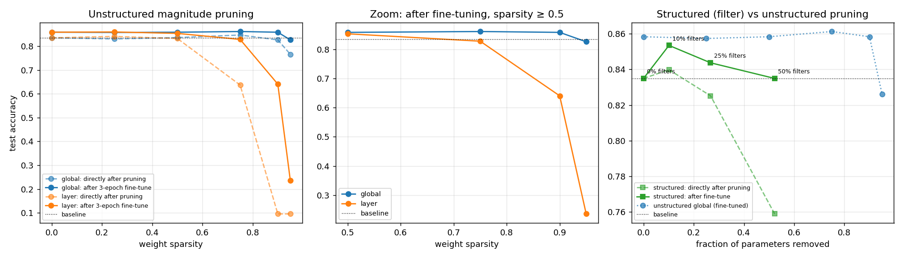
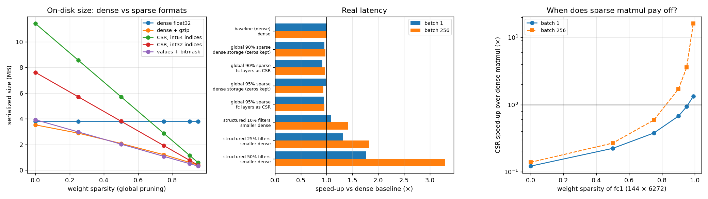
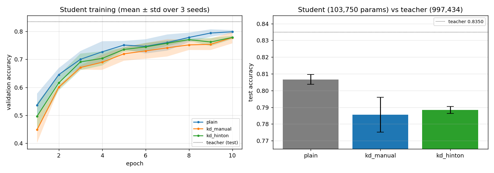

# Lab 7 – Compression: Pruning and Distillation

**Student:** Fatih Alkan (79731)

## 1. Goal

Compress an oversized Fashion-MNIST CNN in two different ways and measure honestly what each method buys: **magnitude pruning** (unstructured – global and per layer – and structured filter pruning) and **knowledge distillation** into a 10× smaller student. The key question is not only how much accuracy survives, but whether a smaller *count* of weights also becomes a smaller *file* and a *faster* model on a real CPU.

Reading: Reddi, Ch. 9 *Efficient AI* (efficiency principles, the data / model / compute / energy pillars, system trade-offs) and Ch. 10 *Model Optimizations* (§10.3 optimization dimensions, §10.4 model compression: pruning and knowledge distillation).

## 2. Method

All steps run with `python lab07/src/run_all.py`.

**Measurement environment.** The results come from one run of `run_all.py` with the pinned environment (Python 3.11.8, torch 2.3.1 CPU build, CodeCarbon 2.4.2) on a GitHub-hosted Linux runner: AMD EPYC 7763, 2 physical cores / 4 logical CPUs, 16 GB RAM, 2 PyTorch threads (`results/versions.txt`). The full run took about 54 minutes. Latency at batch 1 was very stable between repeated measurements (± 2 %). Latency at batch 256 on this shared virtual machine varied by up to ± 30 % between measurements of the *same* model in different scripts (baseline: 54.8 ms in `baseline.csv`, 80.2–80.5 ms in the later scripts). Batch-256 comparisons are therefore made only within one table, and the conclusions about speed rest mainly on batch 1. CodeCarbon cannot read hardware energy counters inside this VM; its numbers are estimates from CPU utilisation and a TDP model, so they are useful for *relative* comparison only. Fashion-MNIST is decoded once into normalised tensors (`Normalize(0.2860, 0.3530)`), with a 55k / 5k train / validation split (seed 42) and the official 10k test set. All training uses Adam and batch 128 on the CPU.

| Step | Script | Output |
|---|---|---|
| 1 | `src/models.py`, `src/baseline.py` | `results/baseline.csv`, `results/baseline_history.csv` |
| 2 | `src/prune_unstructured.py`, `src/prune_structured.py`, `src/plot_pruning.py` | `results/pruning_unstructured.csv`, `results/global_layer_sparsity.csv`, `results/pruning_structured.csv`, `results/sparsity_curves.png` |
| 3 | `src/latency_size.py` | `results/size_formats.csv`, `results/latency_sparse.csv`, `results/sparse_matmul_micro.csv`, `results/latency_size.png` |
| 4 | `src/distill.py` | `results/distillation*.csv`, `results/distillation.png` |
| 5 | `src/summary.py` | `results/efficiency_summary.csv/.md` |

### 2.1 Oversized baseline (step 1)

| Layer | Output | Parameters | FLOPs / image |
|---|---|---|---|
| Conv 1→32, 3×3, pad 1 + ReLU + MaxPool | 32 × 14 × 14 | 320 | 0.45 M |
| Conv 32→64, 3×3, pad 1 + ReLU + MaxPool | 64 × 7 × 7 | 18,496 | 7.23 M |
| Conv 64→128, 3×3, pad 1 + ReLU | 128 × 7 × 7 | 73,856 | 7.23 M |
| Linear 6272→144 + ReLU + Dropout 0.3 | 144 | 903,312 | 1.81 M |
| Linear 144→10 | 10 | 1,450 | 0.003 M |
| **Total** | | **997,434** | **16.7 M** |

About 1.0 M parameters, as the manual asks. Note the imbalance that matters later: **fc1 holds 90.6 % of the parameters but only 11 % of the FLOPs**, while the two 3×3 convolutions do 87 % of the work with 9 % of the weights. Training: 10 epochs, lr 1e-3. Recorded: test accuracy, parameters, size of the saved `state_dict`, FLOPs, latency at batch 1 (median of 200 calls after 20 warm-ups) and batch 256 (median of 30 after 5), and CodeCarbon energy.

### 2.2 Magnitude pruning (step 2)

**Unstructured.** For each target sparsity s ∈ {0, 0.25, 0.5, 0.75, 0.9, 0.95}, always starting from the trained baseline (one-shot pruning):

1. The weights of all Conv2d and Linear layers are ranked by |w| (biases are not pruned; they are 0.1 % of the parameters).
2. A binary mask zeroes the smallest weights:
   - **global** – one threshold, the k-th smallest |w| of the whole network with k = s · N. Layers whose weights are small in magnitude (in practice the huge fc1) lose more than s, and small, important layers lose less (`results/global_layer_sparsity.csv`).
   - **per layer** – each layer loses exactly its own fraction s.
3. Test accuracy is measured directly after pruning.
4. **Fine-tuning:** 3 epochs, Adam lr 3e-4, with the mask fixed. The mask is multiplied into the weights after every optimizer step, so a pruned weight can never come back (checked with an assertion after fine-tuning).

s = 0 is the control: the same 3 extra epochs without pruning, to separate the effect of pruning from the effect of training longer.

**Structured.** In each of conv1, conv2 and conv3 the 10 %, 25 % or 50 % filters with the smallest **L2 norm** (over in-channels × 3 × 3) are removed, together with everything that depends on them:
- the matching input channel of the next convolution;
- for conv3, the 49 inputs of fc1 that come from that channel (flatten order C × H × W).

The network is then **rebuilt as a smaller dense BigCNN** with the surviving weights copied in (`models.structured_prune`), and fine-tuned in the same way (3 epochs, lr 3e-4).

### 2.3 Latency and storage (step 3)

- **Storage formats** for every globally pruned model:
  - dense float32 `state_dict`;
  - dense + gzip;
  - CSR with int64 indices (PyTorch's default);
  - CSR with int32 indices;
  - non-zero values + a 1-bit mask (the cheapest way to say *where* the non-zeros are).
- **Latency** (batch 1 and 256) of:
  - the dense baseline;
  - the 90 % and 95 % globally pruned models stored dense (zeros are still multiplied);
  - the same models with fc1/fc2 executed as **sparse CSR matrix products** (`torch.sparse.mm`). PyTorch has no sparse convolution on the CPU, so the convolutions stay dense;
  - the structurally pruned models.
- **Micro-benchmark:** fc1 alone (144 × 6272), dense matmul vs CSR matmul at sparsity 0 … 0.99, batch 1 and 256, to find the break-even point.

### 2.4 Knowledge distillation (step 4)

- **Teacher:** the oversized baseline, frozen, in eval mode. Its logits for the 55k training images are computed once and stored next to the images in the dataset.
- **Student:** the same layout, much narrower, **103,750 parameters** (9.6× fewer) and 3.56 M FLOPs (4.7× fewer):

  | Layer | Parameters |
  |---|---|
  | Conv 1→16 + ReLU + MaxPool | 160 |
  | Conv 16→32 + ReLU + MaxPool | 4,640 |
  | Conv 32→48 + ReLU | 13,872 |
  | Linear 2352→36 + ReLU | 84,708 |
  | Linear 36→10 | 370 |

- **Loss** (from the manual), T = 4, α = 0.5:

  L = α · CE(student, labels) + (1 − α) · T² · KL( softmax(s/T) ‖ softmax(t/T) )

  The factor T² keeps the gradient of the soft term on the same scale as the CE term when T changes, because the gradients of the softened KL scale with 1/T².
- **KL direction.** The manual writes the KL with the student distribution first, KL(p_s ‖ p_t). This is the "reverse", mode-seeking direction: the student is punished for putting mass where the teacher has little. Hinton et al. (2015) use KL(p_t ‖ p_s), the forward, mass-covering direction, in which the teacher's full distribution (including its small probabilities for wrong classes, the "dark knowledge") is the target. This is also what `nn.KLDivLoss(log_softmax(s/T), softmax(t/T))` computes. The manual's form is the main experiment; the Hinton direction is run as an extra.
- **Runs:** 10 epochs, lr 1e-3, for *plain* (CE only, no teacher), *kd_manual* and *kd_hinton*. Every variant starts from the same initial student weights and sees the same batches. All three are repeated with seeds 42, 43 and 44, because the expected differences are a few tenths of a percent; mean ± standard deviation is reported. Also measured: size, FLOPs, latency, energy and the agreement of the student's test predictions with the teacher's.

### 2.5 Efficiency summary (step 5)

One table with the dense baseline, global 90 % pruning, structured 50 % pruning and the plain and distilled students, organised by the four pillars of Ch. 9. **Data:** training recipe, samples processed, dependence on another model. **Model:** parameters, non-zeros, dense and best sparse size, accuracy. **Compute:** FLOPs executed vs non-zero FLOPs, latency. **Energy:** CodeCarbon training and inference energy. Latency and inference energy are re-measured in one process so that all rows are comparable.

## 3. Results

### 3.1 Baseline (step 1, `results/baseline.csv`)

| Metric | Value |
|---|---|
| Parameters | 997,434 |
| Size (`state_dict`, float32) | 3.81 MB (3,993,478 bytes on disk) |
| FLOPs / image | 16.7 M |
| Validation / **test accuracy** after 10 epochs | 0.9268 / **0.9231** |
| Latency, batch 1 | 0.47 ms |
| Training time / energy | 306 s / 0.0133 kWh (CodeCarbon estimate) |

The oversized network is 3.1 points more accurate than the 20k-parameter CNN of Labs 3 and 6 (89.2 %), at 49× the parameters and 8× the FLOPs, which makes it a good teacher and a good target for compression.

### 3.2 Pruning (step 2)

**Unstructured magnitude pruning** (`results/pruning_unstructured.csv`, test accuracy):

| Sparsity | Global, after pruning | **Global, after 3-epoch fine-tune** | Per layer, after pruning | **Per layer, after fine-tune** |
|---|---|---|---|---|
| 0 (control) | 0.9231 | 0.9307 | 0.9231 | 0.9307 |
| 0.25 | 0.9232 | 0.9323 | 0.9203 | 0.9339 |
| 0.50 | 0.9217 | 0.9324 | 0.8337 | 0.9297 |
| 0.75 | 0.9218 | 0.9314 | 0.4489 | 0.9225 |
| 0.90 | 0.8732 | **0.9284** | 0.0998 | 0.8674 |
| 0.95 | 0.6994 | **0.9189** | 0.1034 | 0.8044 |

The right reference for the fine-tuned columns is the control row (0.9307): the dense model trained for the same 3 extra epochs.

**How the global threshold spreads the sparsity** (`results/global_layer_sparsity.csv`, global 90 %):

| Layer | Weights | Share of all weights | Sparsity at global 90 % |
|---|---|---|---|
| conv1 | 288 | 0.03 % | 19.4 % |
| conv2 | 18,432 | 1.8 % | 70.1 % |
| conv3 | 73,728 | 7.4 % | 77.1 % |
| fc1 | 903,168 | 90.6 % | **91.5 %** |
| fc2 | 1,440 | 0.1 % | 65.1 % |

**Structured filter pruning** (`results/pruning_structured.csv`):

| Filters removed | Channels | Parameters (removed) | FLOPs / image | After pruning | **After fine-tune** | Latency b1 (ms) |
|---|---|---|---|---|---|---|
| 0 % | 32-64-128 | 997,434 (0 %) | 16.7 M | 0.9231 | 0.9231 | 0.470 |
| 10 % | 29-58-116 | 896,244 (10.1 %) | 13.9 M | 0.9166 | **0.9303** | 0.430 |
| 25 % | 24-48-96 | 731,194 (26.7 %) | 9.8 M | 0.9048 | **0.9298** | 0.380 |
| 50 % | 16-32-64 | 476,474 (52.2 %) | 4.7 M | 0.8159 | **0.9270** | 0.287 |

- **The network is heavily over-parameterised.** With *global* pruning, 75 % of the weights can be removed without even fine-tuning (0.9218 vs 0.9231), and after 3 epochs of fine-tuning, 90 % sparsity is only 0.2 points below the dense control (0.9284 vs 0.9307). At 95 % (50k non-zero weights left, fewer than the student in step 4) the model still reaches 91.9 %.
- **Global beats per-layer pruning, increasingly with sparsity.** Per-layer pruning removes the same fraction everywhere: at 90 % it destroys 90 % of the tiny conv1 (288 weights that every feature depends on), and accuracy collapses to chance (0.0998) before fine-tuning. Fine-tuning cannot fully repair it (0.867). The global threshold instead finds where the redundancy is. It prunes fc1 to 91.5 % but leaves conv1 at 19 % and the convolutions at 70–77 %: the large fully connected layer holds most of the redundant (small) weights, the early convolutions almost none.
- **Moderate pruning acts as a regulariser.** At 25–50 % sparsity the fine-tuned models are *slightly better* than the dense control (0.9323–0.9339 vs 0.9307), but these gains are within the noise of a single run.
- **Fine-tuning is essential for structured pruning.** Removing half of all filters costs 10.7 points at once (0.8159). The filters are not individually tiny, and removing them changes every following layer. After 3 epochs the model recovers to 0.9270, only 0.4 points below the dense control, with half the parameters and 3.5× fewer FLOPs. Compared at the same accuracy, unstructured pruning removes more *weights* (90 % vs 52 %), but structured pruning removes more *computation* (72 % vs 0 % actually executed, see step 3).

### 3.3 Latency and storage (step 3)

**On-disk size** (`results/size_formats.csv`, MB):

| Model | Dense float32 | Dense + gzip | CSR, int64 idx | CSR, int32 idx | Values + bitmask |
|---|---|---|---|---|---|
| global 0 % | 3.81 | 3.54 | 11.42 | 7.62 | 3.93 |
| global 50 % | 3.81 | 2.05 | 5.71 | 3.81 | 2.03 |
| global 75 % | 3.81 | 1.21 | 2.86 | 1.91 | 1.08 |
| global 90 % | 3.81 | 0.64 | 1.15 | 0.77 | **0.50** |
| global 95 % | 3.81 | 0.43 | 0.58 | 0.39 | **0.31** |
| structured 50 % filters | 1.82 | 1.69 | 5.46 | 3.64 | 1.88 |

- **A pruned model saved as usual is not smaller at all.** The zeros are still float32 numbers, so every globally pruned `state_dict` is exactly 3.81 MB. Sparsity only saves storage when a sparse format is chosen.
- **Index overhead decides when a sparse format pays off.** CSR stores a column index for every non-zero value. With PyTorch's default int64 indices that is 12 bytes per non-zero instead of 4. CSR is therefore *3× larger* than dense at 0 % sparsity, breaks even only around 67 % sparsity, and reaches 3.3× compression at 90 %. int32 indices halve the overhead (break-even 50 %). A 1-bit mask plus the non-zero values is the most compact format at every sparsity (0.50 MB at 90 %, **7.5× smaller** than dense). Gzip of the dense file comes close, because long runs of zeros compress well.
- Structured pruning simply gives a smaller dense file (1.82 MB at 50 %) that needs no special format or loader.

**Real latency** (`results/latency_sparse.csv`; speed-up vs the dense baseline):

| Model | Execution | Batch 1 (ms) | Speed-up | Batch 256 (ms) | Speed-up | FLOPs executed | Non-zero FLOPs |
|---|---|---|---|---|---|---|---|
| baseline | dense | 0.463 | 1.00× | 80.2 | 1.00× | 16.7 M | 16.7 M |
| global 90 % | dense (zeros kept) | 0.467 | 0.99× | 83.3 | 0.96× | 16.7 M | 4.3 M |
| global 90 % | fc layers as CSR | 0.534 | **0.87×** | 84.2 | 0.95× | – | 4.3 M |
| global 95 % | dense (zeros kept) | 0.465 | 1.00× | 82.8 | 0.97× | 16.7 M | 2.7 M |
| global 95 % | fc layers as CSR | 0.507 | 0.91× | 83.1 | 0.97× | – | 2.7 M |
| structured 10 % | smaller dense | 0.433 | 1.07× | 52.8 | 1.52× | 13.9 M | 13.9 M |
| structured 25 % | smaller dense | 0.379 | 1.22× | 61.2 | 1.31× | 9.8 M | 9.8 M |
| structured 50 % | smaller dense | 0.284 | **1.63×** | 23.6 | **3.39×** | 4.7 M | 4.7 M |

**fc1 alone, dense vs CSR matmul** (`results/sparse_matmul_micro.csv`, speed-up of CSR):

| fc1 sparsity | 0 | 0.5 | 0.75 | 0.9 | 0.95 | 0.99 |
|---|---|---|---|---|---|---|
| batch 1 | 0.11× | 0.19× | 0.34× | 0.60× | 0.81× | 1.22× |
| batch 256 | 0.13× | 0.20× | 0.46× | 1.35× | 3.27× | 14.95× |

**Honest reading.** 90 % unstructured sparsity removed 74 % of the *useful* FLOPs (16.7 M → 4.3 M), but the model did not get faster at all. Stored dense it runs at 0.99×; with its linear layers in CSR it even gets slower (0.87×). The only real speed-ups come from structured pruning, where the network itself becomes smaller: 1.6× at batch 1 and 3.4× at batch 256 for 50 % of the filters.

**Why unstructured sparsity rarely speeds up dense CPU kernels:**

1. **Dense kernels do not look at the values.** A dense GEMM or convolution (oneDNN / MKL) multiplies every weight, zero or not; a zero costs exactly as much as any other number. The FLOP saving exists only on paper unless a different kernel is used.
2. **Sparse kernels pay for irregularity.** CSR needs an index load for every non-zero and indirect (gathered) access to the input, which cannot use SIMD units and caches as well as a dense, contiguous loop. This is why CSR is 9× slower than dense at 0 % sparsity and still slower at 90 % for batch 1. A matrix-vector product is memory-bound, and the indices make the sparse matrix (0.77 MB with int32 indices) not much smaller than the dense one.
3. **The break-even point is very high and depends on the batch.** For fc1, CSR wins only above ≈ 85 % sparsity at batch 256 (where each loaded index is reused for 256 inputs) and only above ≈ 97 % at batch 1. In our network the convolutions, which do 87 % of the work, stay dense in any case, because PyTorch has no sparse CPU convolution. Even a perfect sparse fc1 would save at most the 11 % of the FLOPs that fc1 has.
4. **Overhead does not shrink.** At batch 1 the model takes 0.46 ms, a good part of which is per-operator dispatch. Sparsity removes arithmetic, not operator calls.

Unstructured sparsity therefore pays off in **storage and transfer** (7.5× smaller with a bitmask format), or on hardware or kernels made for it: 2:4 structured sparsity on NVIDIA Ampere tensor cores, dedicated sparse accelerators, very high sparsity with sparse BLAS. For **latency on a general-purpose CPU**, the computation has to become *dense and smaller*: filter/channel pruning, or a smaller architecture (step 4).

### 3.4 Knowledge distillation (step 4)

Mean ± standard deviation over 3 seeds, 10 epochs each (`results/distillation_runs.csv`, `results/distillation.csv`):

| Model | Params | Size | FLOPs / image | Latency b1 / b256 (ms) | **Test accuracy** | Agreement with teacher |
|---|---|---|---|---|---|---|
| Teacher (baseline) | 997,434 | 3.81 MB | 16.7 M | 0.469 / 82.1 | 0.9231 | 1 |
| Student, no teacher (CE) | 103,750 | 0.40 MB | 3.56 M | 0.246 / 21.9 | **0.9072 ± 0.0024** | 0.933 |
| Student, KD as in the manual, KL(p_s ‖ p_t) | 103,750 | 0.40 MB | 3.56 M | 0.246 / 21.9 | 0.9003 ± 0.0046 | 0.937 |
| Student, KD Hinton, KL(p_t ‖ p_s) | 103,750 | 0.40 MB | 3.56 M | 0.246 / 21.9 | **0.9077 ± 0.0018** | **0.942** |

Per seed (test accuracy):

| Seed | plain | KD (manual) | KD (Hinton) |
|---|---|---|---|
| 42 | 0.9056 | 0.8981 | 0.9071 |
| 43 | 0.9099 | 0.8972 | 0.9062 |
| 44 | 0.9060 | 0.9055 | 0.9097 |

- **The student is the cheapest model in the whole lab.** 9.6× fewer parameters, 9.5× smaller file and 4.7× fewer FLOPs than the teacher. It runs **1.9× faster at batch 1** and 3.8× faster at batch 256, and needs 3.7× less inference energy. In exchange it loses about 1.5 points of accuracy (90.7 % vs 92.3 %).
- **Distillation did not measurably improve the student here.** With the manual's loss, KL(p_s ‖ p_t), the student is on average 0.7 points *worse* than without a teacher; it is worse in all three seeds, but only by 0.05 points in seed 44. With the Hinton direction, KL(p_t ‖ p_s), it is 0.05 points better on average, well inside one standard deviation (0.2 points). This is an honest negative result under the given settings:
  - *The task leaves little dark knowledge to transfer.* Fashion-MNIST has 10 classes; the teacher is only 1.6 points better than the plain student; and the student is not tiny (104k parameters already reach 90.7 % on labels alone). Distillation helps most when the gap between teacher and student is large and the teacher's wrong-class probabilities carry structure (many classes, e.g. CIFAR-100).
  - *The KL direction matters.* KL(p_s ‖ p_t) is "mode-seeking": it punishes the student for putting probability where the teacher has little, but it does not reward reproducing the teacher's secondary probabilities, which are exactly the dark knowledge. KL(p_t ‖ p_s) is "mass-covering" and makes the student match the whole softened distribution. That is why the Hinton direction is the standard one, and why it was better than the manual's direction in every seed (+0.9, +0.9, +0.4 points).
  - *Settings were not tuned.* T = 4 and α = 0.5 were prescribed; with 10 epochs and only half the loss weight on the labels, the KD students also spent less of their budget on the hard labels that the test measures.
- **Distillation does make the student behave more like the teacher.** Agreement with the teacher's test predictions rises from 93.3 % (plain) to 94.2 % (Hinton KD), even where accuracy does not change: the student copies the teacher's mistakes as well as its correct answers.
- **Cost of distillation:** a trained teacher (306 s) and one teacher pass over the training data are needed before the student can be trained; the student's own training time is unchanged (≈ 116–118 s).

### 3.5 Efficiency summary by the Ch. 9 pillars (step 5)

`results/efficiency_summary.csv` (latency and inference energy re-measured in one process for all rows; students = seed 42):

| Pillar | Metric | Dense baseline | Unstructured global 90 % | Structured 50 % filters | Student, no teacher | Student, distilled |
|---|---|---|---|---|---|---|
| **Data** | Training recipe | 10 epochs, labels | baseline + 3 fine-tune epochs | baseline + 3 fine-tune epochs | 10 epochs, labels | 10 epochs, labels + teacher soft labels |
| | Training samples processed | 550 k | 715 k | 715 k | 550 k | 605 k (+ teacher's 550 k) |
| | Depends on another model | – | trained baseline | trained baseline | – | trained teacher |
| **Model** | Parameters stored | 997,434 | 997,434 | 476,474 | 103,750 | 103,750 |
| | Non-zero parameters | 997,434 | 100,084 | 476,474 | 103,750 | 103,750 |
| | Size, dense file | 3.81 MB | 3.81 MB | 1.82 MB | 0.40 MB | 0.40 MB |
| | Size, best format | 3.81 MB | **0.50 MB** (bitmask) | 1.82 MB | **0.40 MB** | **0.40 MB** |
| | Test accuracy | 0.9231 | **0.9284** | 0.9270 | 0.9056 | 0.8981 |
| **Compute** | FLOPs executed / image | 16.7 M | 16.7 M | 4.7 M | **3.6 M** | **3.6 M** |
| | Non-zero FLOPs / image | 16.7 M | 4.3 M | 4.7 M | 3.6 M | 3.6 M |
| | Latency, batch 1 | 0.465 ms | 0.470 ms | 0.282 ms | **0.239 ms** | 0.242 ms |
| | Latency, batch 256 | 80.3 ms | 83.3 ms | 23.2 ms | **21.8 ms** | 22.4 ms |
| **Energy** | Training energy, total incl. prerequisites (kWh) | 0.0133 | 0.0172 | 0.0150 | **0.0050** | 0.0183 |
| | Inference energy per 1,000 images (kWh) | 1.28e-5 | 1.31e-5 | 3.70e-6 | **3.49e-6** | 3.56e-6 |

(The "best format" of an unpruned model is its dense file; sparse formats only pay off for the pruned one.)

**Conclusion of the comparison.**
- **No single method wins on all four pillars.**
- **Unstructured pruning wins on the model pillar.** It gives the highest accuracy of all compressed models and the smallest file of the large models, but on the compute and energy pillars it is identical to (or slightly worse than) the dense baseline, because dense CPU kernels still execute every zero. It also *costs* data and energy, since it is trained on top of the baseline.
- **Structured pruning is the best balance.** It keeps almost all the accuracy (−0.4 points against the fine-tuned control), and its savings are real at run time: 3.5× fewer FLOPs, 1.6–3.4× lower latency, 3.5× less inference energy.
- **The student is the cheapest model to run and to train.** It also has the smallest file. Training it from scratch on labels used 2.7× less energy than the baseline, with no teacher and no prior training. The price is about 1.7 points of accuracy. Distillation added cost (it needs the teacher) without an accuracy gain under the manual's settings.

For a deployment with hard latency/size limits (as in my project proposal: ≤ 50 ms, ≤ 5 MB), the practical recipe is therefore a *small dense architecture* (student or structurally pruned network), possibly combined with quantization. Unstructured sparsity is the tool for compressing storage or download size, not for speed on a CPU.

## 4. Conclusions

1. **Over-parameterised networks can lose most of their weights.** 90 % of the weights of the 1 M-parameter CNN were removed with a 0.2-point loss after 3 epochs of fine-tuning. A global threshold is much better than equal per-layer pruning, because it protects the small, critical early convolutions and takes the redundancy from the huge fully connected layer.
2. **Fewer non-zero weights ≠ smaller file ≠ faster model.** The 90 %-sparse model was exactly as large as the dense one until it was stored in a sparse format (with int64 CSR indices it is only 3.3× smaller, with a bitmask 7.5×). It was *not faster* on the CPU, and even slower with sparse matrix kernels (0.87×), because dense kernels multiply zeros and sparse kernels pay for indices and irregular memory access. CSR overtook dense matmul only above ≈ 85–97 % sparsity, depending on the batch.
3. **Real speed comes from removing structure.** Pruning half of the conv filters, or training a narrow student, gives a smaller *dense* network: 1.6–1.9× faster at batch 1 and 3.4–3.8× at batch 256, with no special kernels.
4. **Distillation is not automatic.** With T = 4, α = 0.5 and the KL written as in the manual (student ‖ teacher), the 104k-parameter student was 0.7 points *worse* than the same student trained on labels alone; the standard Hinton direction (teacher ‖ student) was better in every seed but only on par with the plain student. On a 10-class task with a small teacher–student gap there was little dark knowledge to transfer. The student itself is still the cheapest model of the lab to train and to run.
